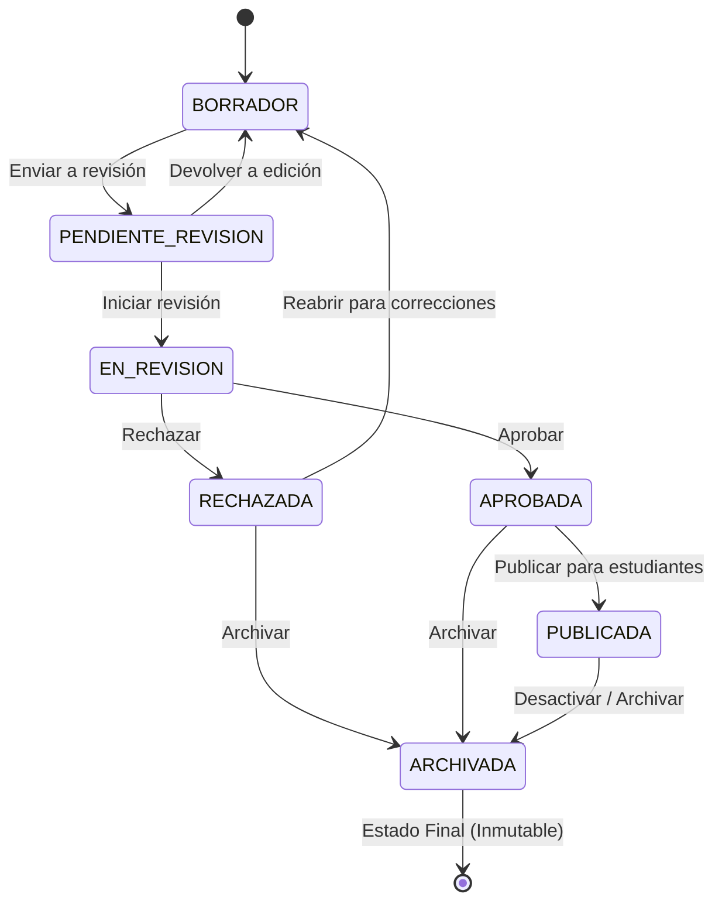
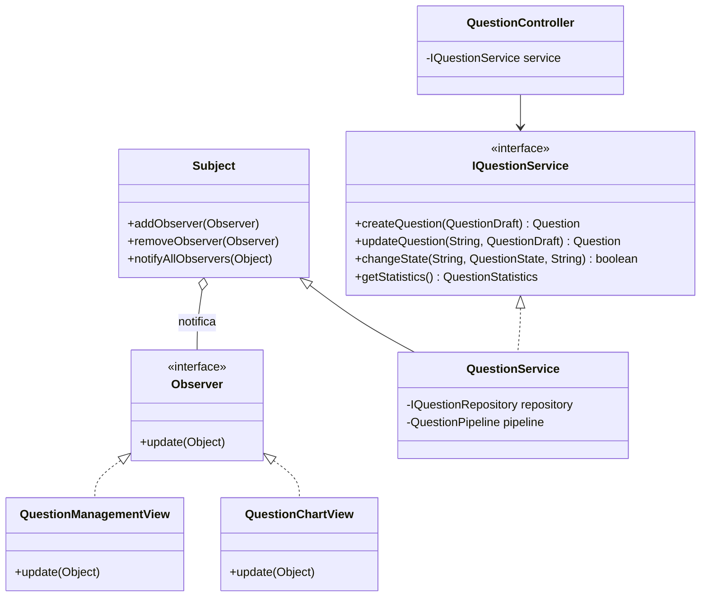
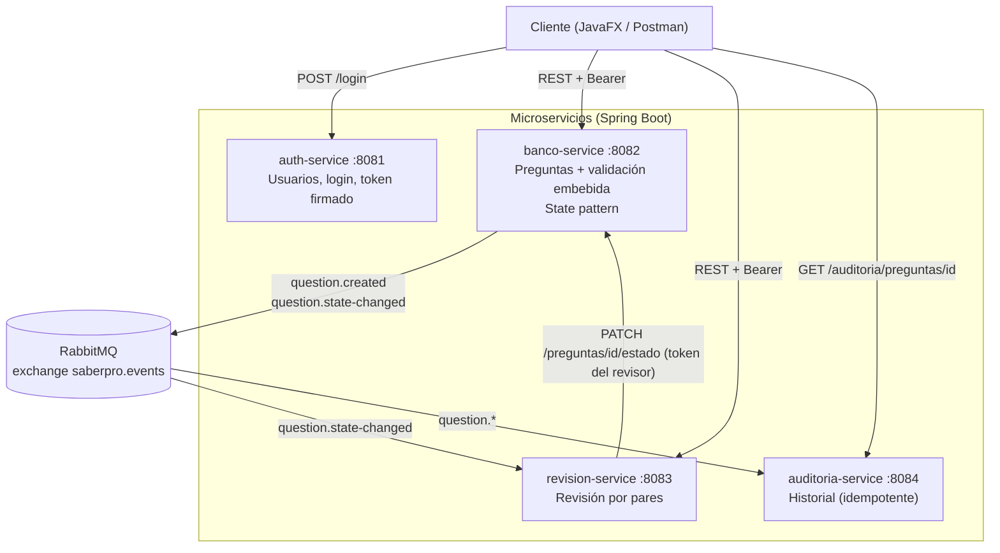
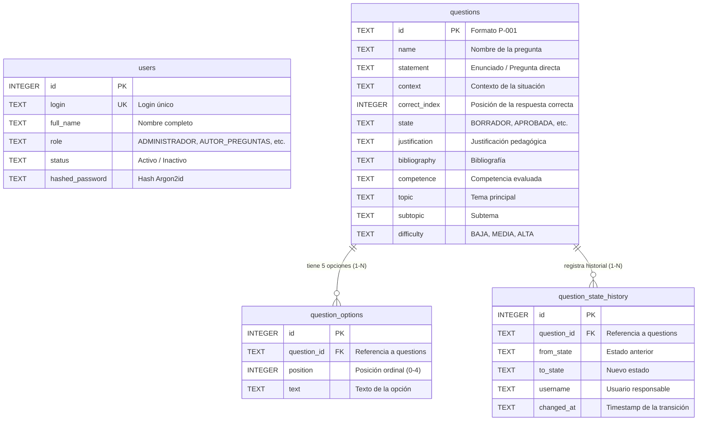

# Contexto y Documentación Técnica del Proyecto: Banco de Preguntas Saber Pro

> **Asignatura:** Laboratorio de Ingeniería de Software II (2026.2)  
> **Institución:** Universidad del Cauca — Facultad de Ingeniería Electrónica y Telecomunicaciones, Popayán  
> **Equipo Desarrollador:** *"Sin Nombre"*  
> **Integrantes:** Juan Manuel Meneses Daza, Juan Sebastian Muñoz Ruiz, Juan Sebastian Molano Bolaños, Santiago Rodríguez Bolaños  
> **Repositorio:** [github.com/BastianRu/proyecto-saberpro-ing-software-II](https://github.com/BastianRu/proyecto-saberpro-ing-software-II)  
> **Gestor de Tareas:** Jira Software ([Tablero Jira](https://unicauca-team-vpqtq3w8.atlassian.net/))

---

## 1. Visión General del Proyecto

El **Banco de Preguntas Saber Pro** es un sistema diseñado para la gestión integral del ciclo de vida de preguntas de selección múltiple con única respuesta, orientadas a la preparación y entrenamiento de estudiantes del programa de Ingeniería de Sistemas en las pruebas de Estado Saber Pro.

El proyecto aborda desde el registro seguro y control de acceso basado en roles de los usuarios, la formulación estricta de preguntas con validaciones de calidad pedagógica y técnica, la gestión de estados a través de un flujo formal de revisión y aprobación con trazabilidad y auditoría, hasta la visualización reactiva de estadísticas y métricas del banco.

---

## 2. Evolución Arquitectónica

El proyecto está concebido en fases o iteraciones académicas estructuradas:

```
[Iteración 1: Monolito en Capas] ────────> [Iteración 2: Arquitectura de Microservicios]
  • Java SE 17 + JavaFX 21                   • Spring Boot 3.3.5
  • SQLite monolítico (taller2.db)           • Descentralización de datos (Database-per-service)
  • Patrones: MVC, Observer,                 • Comunicación síncrona REST + asíncrona (RabbitMQ)
    Pipeline, State, Inversión Dep.          • auth, banco (+validación), revisión, auditoría
```

### Iteración 1: Monolito en Capas y Patrones de Diseño
* **Enfoque:** Monolito local de escritorio en Java SE 17 con interfaz gráfica JavaFX 21 y base de datos relacional embebida SQLite (`taller2.db`).
* **Objetivo de Diseño:** Demostrar el dominio manual de principios **SOLID** (con énfasis en el Principio de Inversión de Dependencias - DIP) y patrones de diseño GoF y arquitectónicos sin delegar la lógica a contenedores mágicos de frameworks.
* **Separación de Capas:**
  - `presentation / ui`: Vistas JavaFX y controladores.
  - `service`: Lógica de negocio, servicios e interfaces de servicio.
  - `access`: Acceso a datos, persistencia JDBC SQLite y seguridad.
  - `domain`: Modelos de negocio puros, entidades inmutables y reglas de dominio.
  - `pipeline`: Tuberías y filtros para validación estructural de borradores.
  - `infra`: Infraestructura transversal desacoplada (Observer, Subject).
  - `main`: Punto de entrada (`MainApp`) que compone e inyecta dependencias manualmente.

### Iteración 2: Transición a Microservicios (Rama Actual: `segunda_iteracion`)
* **Enfoque:** Refactorización hacia una arquitectura distribuida orientada a microservicios con **Spring Boot 3.3.5**, comunicación HTTP/REST y mensajería orientada a eventos con **RabbitMQ**.
* **Patrón de Datos:** *Database per Service* (cada servicio gestiona de forma autónoma su propio almacenamiento).
* **Ajustes de diseño respecto al documento de arquitectura inicial** (decididos por el equipo):
  1. **Banco y Validación en un solo servicio:** la tubería de filtros corre dentro del Banco; ya no hay `validacion-service`.
  2. **Los eventos del Banco los consumen Revisión y Auditoría** (cada una con su propia cola).
  3. **`revision-service` ocupa el lugar del servicio de Validación** (revisión por pares, HU05).
  4. **`QuestionState` pasa de enum a una jerarquía de clases** (patrón State).
* **Módulos y Servicios de la Solución:**
  1. **`auth-service` (Puerto 8081):** autenticación, credenciales (Argon2id) y emisión de tokens firmados (HMAC-SHA256, vencimiento en UTC). Base de datos `auth.db`.
  2. **`banco-service` (Puerto 8082):** preguntas, validación estructural embebida (pipeline de 7 filtros), ciclo de vida con patrón State, consulta multicriterio, matriz de roles y publicación de eventos `QuestionCreated` y `QuestionStateChanged`. Base de datos `banco.db`.
  3. **`revision-service` (Puerto 8083):** consume `QuestionStateChanged`, crea revisiones y, cuando un revisor emite su dictamen, llama por REST al Banco para ejecutar la transición. Base de datos `revision.db`.
  4. **`auditoria-service` (Puerto 8084):** consume los eventos del Banco de forma idempotente y expone el historial. Base de datos `auditoria.db`.
  5. **Cliente de Escritorio (`src/`):** aplicación JavaFX adaptada para el login contra `auth-service` mediante `RestAuthClient` y sesiones con token Bearer (`Session`). El resto del cliente aún usa el Banco local.

---

## 3. Historias de Usuario y Funcionalidades

### HE1: Gestión de Usuarios (HU01)
* **Objetivo:** Registro, autenticación y control de usuarios para determinar quién usa el sistema y con qué privilegios.
* **Roles del Sistema:**
  - `ADMINISTRADOR`: Gestión global de usuarios y control total del banco de preguntas.
  - `AUTOR_PREGUNTAS`: Creación, edición de preguntas en borrador y envío a revisión.
  - `REVISOR`: Evaluación, retroalimentación, aprobación o rechazo de preguntas en revisión.
  - `DOCENTE` y `ESTUDIANTE`: Consulta de preguntas publicadas e información académica.
* **Seguridad y Criptografía:**
  - Almacenamiento seguro mediante algoritmo de derivación de claves **Argon2id** (`argon2-jvm`), descartando algoritmos rápidos vulnerables como MD5 o SHA-1.
  - **Política de contraseñas (`PasswordPolicy`):** Longitud mínima de 6 caracteres, al menos un dígito, al menos una letra mayúscula y al menos un carácter especial (`!@#$%^&*()_+-=[]{}|;:,.<>?`).
  - Nombre de usuario (`login`) único en el sistema.

### HE2: Gestión del Banco de Preguntas (HU02)
* **Objetivo:** Creación, edición y búsqueda estructurada de preguntas tipo Saber Pro.
* **Componentes de una Pregunta (`Question` / `QuestionDraft`):**
  - **Identificador:** Consecutivo estandarizado (`P-001`, `P-002`, ...).
  - **Nombre / Título:** Identificador legible de la pregunta.
  - **Contexto:** Enunciado o caso de estudio motivador (mínimo 20 caracteres).
  - **Pregunta Directa:** Interrogante concreto terminado en `?` (RF-09).
  - **Opciones de Respuesta:** Exactamente 5 opciones (4 distractores y 1 respuesta correcta).
  - **Metadatos Pedagógicos:** Competencia evaluada, Tema, Subtema, Nivel de dificultad (`BAJA`, `MEDIA`, `ALTA`).
  - **Soporte Académico:** Justificación explicativa y bibliografía de respaldo.
* **Búsqueda Multicriterio (`QuestionCriteria`):** Filtrado simultáneo o individual por estado, nivel de dificultad, competencia, tema, subtema y coincidencia de texto.
* **Regla de Inmutabilidad:** Solo se permite modificar preguntas que permanezcan en estado `BORRADOR`.

### HE3: Validación Estructural de Preguntas (HU03)
* **Objetivo:** Garantizar la consistencia pedagógica y formal de las preguntas antes de persistirlas.
* **Implementación:** Patrón arquitectónico **Pipeline (Tuberías y Filtros)**. Un borrador recorre una secuencia lineal de filtros; si una regla falla, el flujo se detiene inmediatamente y emite una `ValidationException` con los códigos y detalles del error.

| Orden | Filtro | Requisito | Regla de Validación |
| :---: | :--- | :---: | :--- |
| **1** | `ContextFilter` | RF-08 | Contexto presente y con un mínimo de 20 caracteres. |
| **2** | `DirectQuestionFilter` | RF-09 | Pregunta directa única, en formato de interrogación (termina en `?` y contiene solo un `?`). |
| **3** | `DistractorCountFilter` | RF-10 | Exactamente 4 distractores (5 opciones en total sumando la respuesta correcta). |
| **4** | `ForbiddenExpressionFilter` | RF-12 | Prohibición estricta de expresiones como *"Todas las anteriores"* y *"Ninguna de las anteriores"*. |
| **5** | `DistractorFormatFilter` | RF-13 | Opciones no vacías, de al menos 3 caracteres, con mayúscula inicial y sin repetirse entre sí. |
| **6** | `CorrectAnswerFilter` | RF-11 | Una única respuesta correcta con índice válido (entre 0 y 4), no duplicada en el conjunto. |
| **7** | `RequiredFieldsFilter` | RF-05 | Obligatoriedad de todos los campos: nombre, justificación, bibliografía, competencia, tema, subtema y dificultad. |

### HE4: Gestión del Ciclo de Vida y Auditoría (HU04)
* **Objetivo:** Administrar las fases por las que transita una pregunta, impidiendo inconsistencias de estado y registrando auditoría histórica.
* **Implementación:** Patrón **State (Máquina de Estados)** encapsulado en el enumerado `QuestionState`.
* **Regla de Integridad:** No existe borrado físico de preguntas en el banco; una pregunta rechazada o descartada pasa al estado `ARCHIVADA`.

#### Diagrama de Transición de Estados


* **Auditoría de Estados (`QuestionStateChange`):** Cada transición exitosa se registra en la tabla `question_state_history` guardando:
  - `question_id`: Identificador de la pregunta.
  - `from_state`: Estado origen.
  - `to_state`: Estado destino.
  - `username`: Usuario que autorizó o ejecutó la acción.
  - `changed_at`: Marca temporal exacta (`LocalDateTime`).
* **Reactividad:** El cambio de estado dispara notificaciones automáticas mediante el patrón Observer para actualizar en tiempo real el contador y el gráfico circular de distribución de estados.

---

## 4. Patrones de Diseño de Software Aplicados

El proyecto destaca por su rigor en el uso de patrones de diseño GoF y principios de ingeniería de software:



1. **Inversión de Dependencias (DIP - SOLID):**
   - Las capas superiores no dependen de clases concretas de infraestructura, sino de contratos abstractos (`IUserService`, `IUserRepository`, `IQuestionService`, `IQuestionRepository`, `IAuthClient`, `IPasswordHasher`).
   - Facilita el cambio de persistencia (ej. de SQLite a PostgreSQL) o de transporte (ej. llamadas en memoria a clientes HTTP REST).
2. **Micro-patrón MVC (Model-View-Controller):**
   - **Modelo:** `QuestionService` (gestiona la lógica de negocio y las reglas del dominio).
   - **Controlador:** `QuestionController` (media entre los eventos de la vista y las operaciones del servicio).
   - **Vistas:** `QuestionManagementView`, `QuestionEditorView`, `QuestionStatisticsView`, `QuestionChartView`.
3. **Patrón Observer (Sujeto - Observador):**
   - `QuestionService` hereda de `Subject`.
   - Cuando se modifica una pregunta o cambia de estado, el servicio calcula las nuevas estadísticas (`QuestionStatistics`) y notifica automáticamente a todas las vistas observadoras registradas sin acoplarse a JavaFX.
4. **Patrón Pipeline (Tuberías y Filtros):**
   - `QuestionPipeline` encadena instancias que implementan la interfaz `Filter`.
   - Permite componer, alterar el orden o agregar nuevas validaciones fácilmente respetando el principio Abierto/Cerrado (OCP).
5. **Patrón State (Máquina de Estados):**
   - Cada constante del enumerado `QuestionState` implementa el método `allowedTransitions()`, delimitando de forma segura los saltos de estado válidos.
   - **Iteración 2:** en `banco-service` el enum se reemplazó por una jerarquía de clases (`QuestionState` abstracta con una subclase por estado). Cada estado sobrescribe solo las operaciones que le son legales y las demás lanzan `InvalidStateOperationException`; el cambio de estado usa doble despacho, sin `switch`.
6. **Patrón Data Transfer Object (DTO):**
   - Objetos inmutables como `QuestionDraft`, `QuestionDraftRequest`, `ValidationResponse`, `RegisterRequest`, `LoginResponse` para desacoplar el transporte de datos de las entidades internas.

---

## 5. Arquitectura de Microservicios (Iteración 2)



Banco, Revisión y Auditoría **verifican el token localmente** (mismo secreto que `auth-service`), sin llamarlo en cada petición.

### Flujo de una pregunta
1. El autor crea la pregunta (`POST /preguntas`). El Banco la valida, la guarda en `BORRADOR` y publica `QuestionCreated`.
2. El autor la envía a revisión (`PATCH /preguntas/{id}/estado`). El Banco publica `QuestionStateChanged`; Revisión crea una revisión pendiente y Auditoría registra el cambio.
3. Un revisor toma la revisión: Revisión pide al Banco el paso a `EN_REVISION`.
4. El revisor emite el dictamen: el Banco pasa la pregunta a `APROBADA` o `RECHAZADA`.
5. Auditoría tiene el historial completo, que se consulta con `GET /auditoria/preguntas/{id}`.

### Detalle de los Microservicios

Cada servicio tiene su propio `README.md` con endpoints, reglas y ejecución.

| Servicio | Puerto | Persistencia | Entrada | Salida |
|---|---|---|---|---|
| `auth-service` | 8081 | `auth.db` | REST | token firmado |
| `banco-service` | 8082 | `banco.db` | REST | eventos a RabbitMQ |
| `revision-service` | 8083 | `revision.db` | REST + cola `revision.preguntas` | REST hacia el Banco |
| `auditoria-service` | 8084 | `auditoria.db` | cola `auditoria.preguntas` + REST | — |

**Matriz de roles en el Banco:** crear y editar, `ADMINISTRADOR` y `AUTOR_PREGUNTAS`; cambiar estado, `ADMINISTRADOR`, `AUTOR_PREGUNTAS` y `REVISOR`; consultar, cualquier usuario autenticado.

**Herramientas:** `docker-compose.yml` (RabbitMQ) y la colección de Postman `postman/saberpro-microservicios.postman_collection.json`.

---

## 6. Modelo de Datos Relacional

### Esquema Inicial (Monolito) y Descentralizado
En la Iteración 1, las tablas residen en `taller2.db`. En la Iteración 2, `users` reside en `auth.db`, `questions` y `question_options` en `banco.db`, y el historial de cambios de estado (`question_state_history` del monolito) pasa a `audit_records` en `auditoria.db`, alimentada por eventos. `revision-service` agrega `reviews` y `processed_events` en `revision.db`. Entre servicios solo se referencia por identificador, sin llaves foráneas.



---

## 7. Estrategia de Pruebas y Aseguramiento de Calidad

El proyecto implementa una batería exhaustiva de pruebas automáticas con **JUnit 5** y **Mockito**:

1. **Dobles de Prueba Manuales (*Fakes*):**
   - `FakeUserRepository`, `FakeQuestionRepository`, `FakePasswordHasher`.
   - Permiten probar toda la lógica de negocio de los servicios de forma determinística y veloz en memoria sin necesidad de levantar bases de datos reales.
2. **Pruebas con Mockito:**
   - Pruebas sobre interfaces (`QuestionServiceMockitoTest`, `QuestionControllerMockitoTest`).
   - Uso de `ArgumentCaptor` para certificar que los datos de auditoría se capturan y envían fielmente a los repositorios.
3. **Pruebas de Repositorio sobre SQLite:**
   - Pruebas reales de persistencia usando conexiones SQLite en memoria (`:memory:`), validando esquemas, transacciones y consultas de historial.
4. **Pruebas de Pipeline y Filtros:**
   - Pruebas independientes para cada uno de los 7 filtros verificando tanto casos límite positivos como negativos, más pruebas completas de integración de punta a punta (`QuestionPipelineTest`).
5. **Pruebas de Integración y API REST:**
   - Pruebas de contrato HTTP con `MockMvc` en `auth-service`, `banco-service`, `revision-service` y `auditoria-service`.
6. **Validación de Usabilidad (Thinking Aloud):**
   - Sesión experimental documentada con 3 estudiantes ajenos al equipo de desarrollo, evaluando los flujos de inicio de sesión, redacción con el editor de preguntas, búsqueda por filtros y cambio de estados, recopilando oportunidades de mejora ergonómica y visual.

---

## 8. Estructura del Repositorio

```
proyecto-saberpro-ing-software-II/
│
├── auth-service/                       # Microservicio de Autenticación (Spring Boot 3.3.5)
│   ├── src/main/java/                  # Controladores REST, TokenSigner, UserService, Argon2
│   ├── src/main/resources/             # application.properties (puerto 8081, auth.db)
│   ├── src/test/java/                  # Pruebas unitarias y de integración REST
│   └── pom.xml
│
├── banco-service/                      # Banco + validación embebida + State pattern (8082)
├── revision-service/                   # Revisión por pares (8083)
├── auditoria-service/                  # Historial por eventos (8084)
├── postman/                            # Colección de Postman de todo el flujo
├── docker-compose.yml                  # RabbitMQ
│
├── docs/                               # Documentación de Diseño y Arquitectura
│   ├── Decisiones_Tecnicas_...pdf      # Justificación técnica de alternativas elegidas y descartadas
│   ├── Documento_Arquitectura_...pdf   # Documento C4, Modelo 4+1, Usabilidad, Pruebas
│   └── MiniQAW_...xlsx                 # Atributos de calidad y escenarios QAW
│
├── src/                                # Monolito Inicial y Cliente Desktop JavaFX
│   ├── main/java/com/unicauca/lisw2t2g08/
│   │   ├── access/                     # SQLiteQuestionRepository, SQLiteUserRepository, RestAuthClient
│   │   ├── domain/                     # User, Question, Session, PasswordPolicy, QuestionState
│   │   ├── infra/                      # Subject, Observer (Patrón Observer)
│   │   ├── main/                       # MainApp (ensamblador e inyector de dependencias)
│   │   ├── pipeline/                   # Pipeline y filtros (monolito)
│   │   ├── service/                    # QuestionService, UserService, interfaces
│   │   └── ui/                         # Vistas JavaFX y QuestionController (MVC)
│   └── test/java/                      # 152 pruebas automatizadas del monolito
│
├── pom.xml                             # Configuración Maven principal del cliente/monolito
└── README.md                           # Guía general de ejecución y resumen del proyecto
```

---

## 9. Instrucciones de Compilación y Ejecución

### Prerrequisitos
* **Java Development Kit (JDK):** Versión 17 o superior.
* **Apache Maven:** Versión 3.8 o superior.
* **RabbitMQ** (para mensajería en `banco-service`): Corriendo en `localhost:5672`.

### 1. Ejecutar el Monolito / Cliente Gráfico (JavaFX)
Desde la raíz del repositorio:
```bash
mvn clean compile
mvn javafx:run
```

### 2. Ejecutar `auth-service`
```bash
cd auth-service
mvn spring-boot:run
```
*Disponible en:* `http://localhost:8081`

### 3. Ejecutar el resto de los servicios
```bash
docker compose up -d        # RabbitMQ (puertos 5672 y 15672)
cd banco-service     && mvn spring-boot:run   # http://localhost:8082
cd revision-service  && mvn spring-boot:run   # http://localhost:8083
cd auditoria-service && mvn spring-boot:run   # http://localhost:8084
```

### 4. Ejecutar Pruebas Unitarias
Para correr la suite de pruebas en cualquier módulo:
```bash
mvn test
```
