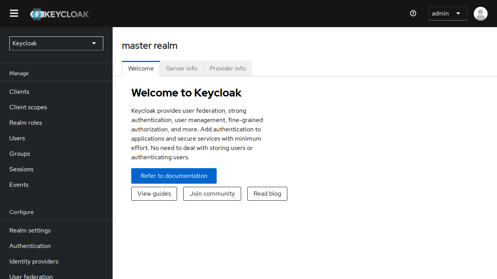
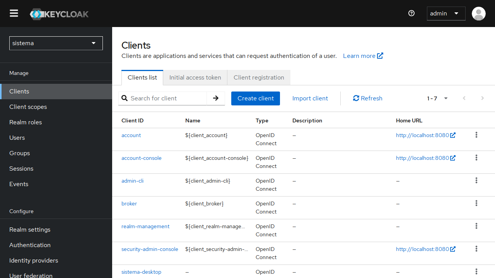
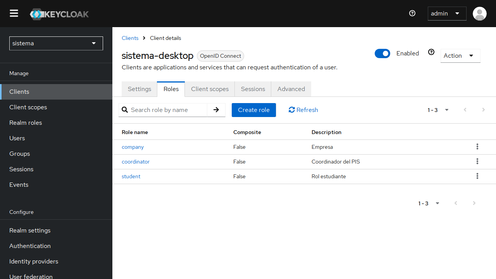
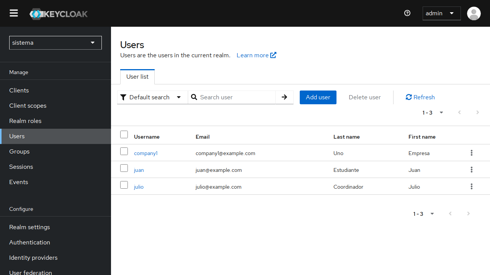
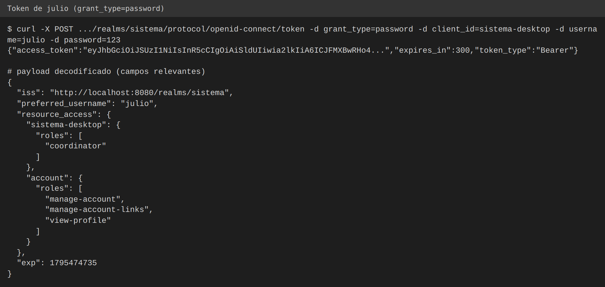
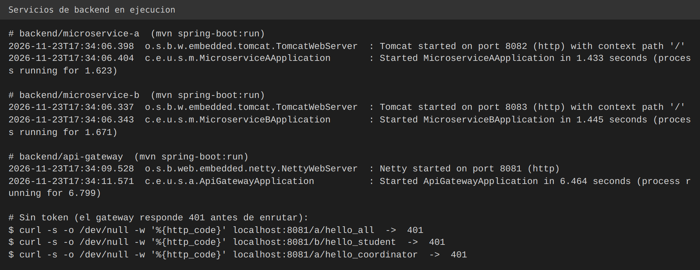
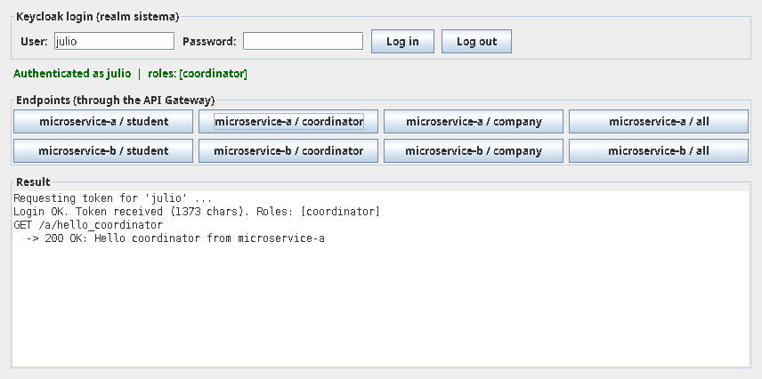
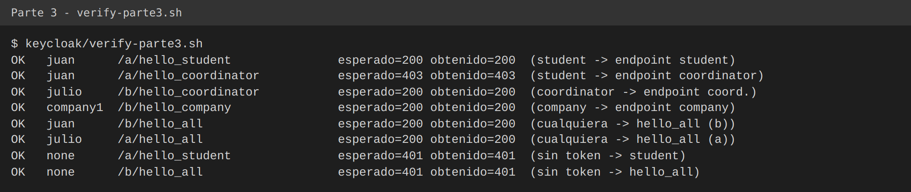
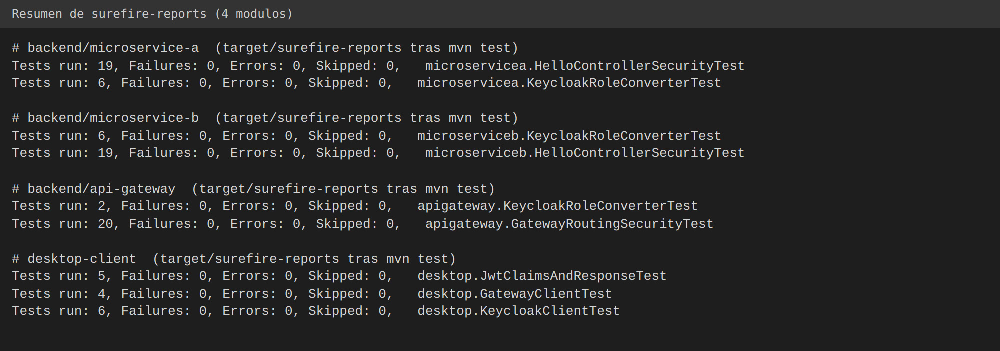

::: {custom-style="Portada"}
{width=3.2cm}
:::

::: {custom-style="Portada"}
**INFORME TALLER 12**\
**AUTENTICACIÓN Y AUTORIZACIÓN CON KEYCLOAK, SPRING BOOT Y JAVA SWING**
:::

::: {custom-style="Portada"}
**JUAN SEBASTIAN MUÑOZ RUIZ**

**JUAN SEBASTIAN MOLANO BOLAÑOS**
:::

::: {custom-style="Portada"}
**Profesor:**\
**PABLO A. MAGÉ I.**
:::

::: {custom-style="Portada"}
**Universidad del Cauca**\
**Facultad de Ingeniería Electrónica y Telecomunicaciones**\
**Departamento de Sistemas**\
**Laboratorio de Ingeniería de Software II**
:::

::: {custom-style="Portada"}
**Popayán, noviembre 2026**
:::

```{=openxml}
<w:p><w:r><w:br w:type="page"/></w:r></w:p>
```

::: {custom-style="Portada"}
**JUAN SEBASTIAN MUÑOZ RUIZ**

**JUAN SEBASTIAN MOLANO BOLAÑOS**

**INFORME TALLER 12: AUTENTICACIÓN Y AUTORIZACIÓN CON KEYCLOAK, SPRING BOOT Y JAVA SWING**

Taller No. 12 presentado en el curso de Laboratorio de Ingeniería de Software II

**Estudiantes del:**\
**Programa de Ingeniería de Sistemas**

**Profesor:**\
**PABLO A. MAGÉ I.**

**Popayán / 2026**
:::

```{=openxml}
<w:p><w:r><w:br w:type="page"/></w:r></w:p>
```

# Contenido {.unnumbered}

1.- Contexto del proyecto

2.- Objetivos

3.- Parte 1: Instalación y configuración de Keycloak

&emsp;&emsp;3.1.- Instalación y ejecución

&emsp;&emsp;3.2.- Realm, cliente y roles

&emsp;&emsp;3.3.- Usuarios y obtención del token

4.- Parte 2: Descarga y ejecución del sistema

&emsp;&emsp;4.1.- Arquitectura

&emsp;&emsp;4.2.- Estructura del proyecto y ejecución

&emsp;&emsp;4.3.- Ajustes realizados sobre la demo

5.- Parte 3: Casos de prueba

6.- Parte 4: Análisis del código fuente

&emsp;&emsp;6.1.- API Gateway

&emsp;&emsp;6.2.- Microservicios

&emsp;&emsp;6.3.- Cliente Desktop

7.- Pruebas automatizadas

8.- Conclusiones

9.- Repositorio del proyecto

```{=openxml}
<w:p><w:r><w:br w:type="page"/></w:r></w:p>
```

# 1.- Contexto del proyecto

El presente informe documenta el desarrollo del Taller No. 12 del curso de Laboratorio de Ingeniería de Software II (Programa de Ingeniería de Sistemas, Periodo 2-2026), cuyo propósito es implementar, configurar y comprender un sistema distribuido que autentica y autoriza mediante JWT (JSON Web Token) usando Keycloak como proveedor de identidad (Identity Provider), un cliente de escritorio en Java Swing, un API Gateway y dos microservicios protegidos por roles.

El taller parte de la demo de autenticación y autorización entregada por el docente (`demo-autenticacion-autorizacion`: `api-gateway`, `microserviceA`, `microserviceB` y `Client`). Siguiendo la guía, primero se configuró Keycloak (Parte 1), luego se compilaron y ejecutaron los módulos (Parte 2), se ejecutaron los casos de prueba de la guía (Parte 3) y se analizó el código fuente (Parte 4). Durante la lectura de la demo se detectaron diferencias entre lo que pide la guía y lo que el código entregado hace; por ello, la solución se reimplementó corrigiéndolas y se le agregaron pruebas automatizadas (sección 4.3 y sección 7).

La Parte 5 de la guía (aplicar el sistema al proyecto del curso, el Banco de Preguntas Saber Pro) no hace parte de lo exigido para este informe (la sección "¿Qué se debe entregar?" pide evidenciar las Partes 1, 2, 3 y 4) y no se implementó en esta entrega.

# 2.- Objetivos

- Configurar Keycloak con un realm, un cliente OpenID Connect, roles y usuarios, y comprender el flujo OAuth2 de obtención de un JWT.
- Implementar un cliente de escritorio en Java Swing que se autentique contra Keycloak y consuma un backend protegido.
- Integrar un API Gateway (Spring Cloud Gateway) con dos microservicios Spring Boot 3.4.5 aplicando autorización basada en roles.
- Verificar los casos de prueba de la guía (200 permitido, 403 sin el rol, 401 sin token).
- Analizar dónde se valida el JWT, cómo se enrutan las peticiones, cómo se propaga el token y cómo se protegen los endpoints.
- Cubrir el comportamiento de seguridad con pruebas automatizadas que no dependan de un Keycloak en ejecución.

# 3.- Parte 1: Instalación y configuración de Keycloak

## 3.1.- Instalación y ejecución

Se descargó Keycloak 25.0.6 en su distribución binaria (zip) desde el repositorio oficial del proyecto y se ejecutó en modo desarrollo (`start-dev`) en el puerto 8080, con Java 17 y un usuario administrador local de desarrollo. No se usó Docker.

```
$ KEYCLOAK_ADMIN=admin KEYCLOAK_ADMIN_PASSWORD=admin bin/kc.sh start-dev --http-port=8080
```

{width=14cm}

## 3.2.- Realm, cliente y roles

Los pasos 4 a 6 de la guía se automatizaron con el script `keycloak/setup-realm.sh` (administración con `kcadm.sh`), para que la configuración sea reproducible. Los resultados se comprobaron en la consola de administración:

| Elemento | Valor | Detalle |
|----|-----|----------|
| Realm | `sistema` | Aísla usuarios, clientes y roles del realm `master`. |
| Cliente | `sistema-desktop` | OpenID Connect, cliente público, con **Direct access grants** habilitado (permite el flujo `grant_type=password` desde la aplicación de escritorio). |
| Roles del cliente | `student`, `coordinator`, `company` | Son *client roles*: en el token aparecen en `resource_access.sistema-desktop.roles`. |

{width=14cm}

{width=14cm}

## 3.3.- Usuarios y obtención del token

Se crearon los usuarios de la guía con contraseña `123` (con username, first name, last name y email diligenciados, requisito de Keycloak para poder emitir el token):

| Usuario | Rol asignado (cliente sistema-desktop) |
|---|---|
| `juan` | `student` |
| `julio` | `coordinator` |
| `company1` | `company` |

{width=14cm}

La obtención del token (paso 8) se probó con `curl` contra el *token endpoint* del realm, con el mismo formulario `x-www-form-urlencoded` de la Figura 5 de la guía:

```
POST http://localhost:8080/realms/sistema/protocol/openid-connect/token
grant_type=password & client_id=sistema-desktop & username=julio & password=123
```

{width=15cm}

# 4.- Parte 2: Descarga y ejecución del sistema

## 4.1.- Arquitectura

Definición: un *API Gateway* es un punto de entrada único que recibe las peticiones de los clientes y las reenvía al servicio correspondiente; aquí además valida el JWT. Un *resource server* (OAuth2) es un servicio que protege sus recursos exigiendo un access token válido.

| Componente | Puerto | Responsabilidad |
|---|---|---|
| Keycloak (realm `sistema`) | 8080 | Autentica al usuario y emite el JWT firmado (RS256) con sus roles. |
| `api-gateway` | 8081 | Valida el JWT, aplica la primera comprobación de roles y enruta `/a/**` y `/b/**`. |
| `microservice-a` | 8082 | Resource server; endpoints `hello_student`, `hello_coordinator`, `hello_company`, `hello_all`. |
| `microservice-b` | 8083 | Idéntico a A (cambian el nombre y el puerto). |
| `desktop-client` | — | Aplicación Java Swing: login contra Keycloak y llamadas al gateway con el token. |

Flujo: (1) el cliente envía usuario y contraseña a Keycloak; (2) Keycloak devuelve el JWT; (3) el cliente llama al gateway con `Authorization: Bearer <JWT>`; (4) el gateway valida el token y el rol y reenvía la petición (con el mismo header) al microservicio; (5) el microservicio vuelve a validar el token y el rol antes de ejecutar el método.

## 4.2.- Estructura del proyecto y ejecución

```
Autenticacion-Keycloak/
├── keycloak/          setup-realm.sh, verify-parte3.sh
├── backend/
│   ├── api-gateway/       # Puerto 8081 (Spring Cloud Gateway, WebFlux)
│   ├── microservice-a/    # Puerto 8082 (Spring MVC)
│   └── microservice-b/    # Puerto 8083 (Spring MVC)
└── desktop-client/    # Cliente Java Swing
```

Cada módulo es un proyecto Maven independiente (Java 17, Spring Boot 3.4.5, Spring Cloud 2024.0.1 en el gateway). Se compilan y ejecutan con:

```
(cd backend/microservice-a && mvn spring-boot:run)
(cd backend/microservice-b && mvn spring-boot:run)
(cd backend/api-gateway     && mvn spring-boot:run)
(cd desktop-client          && mvn exec:java)
```

{width=15cm}

{width=15cm}

## 4.3.- Ajustes realizados sobre la demo

Al leer la demo se encontraron diferencias con el enunciado y puntos que impedirían su funcionamiento correcto. Se registran aquí porque la solución entregada los corrige (los hallazgos provienen de la revisión del código; los comportamientos de la solución corregida sí están cubiertos por pruebas):

| # | Demo | Solución entregada | Por qué |
|-|----------|----------|----------|
| 1 | `Client/Main.java` es una aplicación de consola con usuario y contraseña fijos. | Cliente Swing (`MainFrame`) con formulario de login y un botón por endpoint. | La guía exige un cliente desktop en Java Swing. |
| 2 | El gateway usa `@EnableWebSecurity` con `SecurityWebFilterChain`. | `@EnableWebFluxSecurity`. | Spring Cloud Gateway es reactivo (WebFlux); `@EnableWebSecurity` pertenece a la pila servlet. |
| 3 | El gateway exige `hasRole(..)` pero no define cómo convertir el JWT en roles. | `KeycloakRoleConverter` adaptado con `ReactiveJwtAuthenticationConverterAdapter`. | Por defecto Spring mapea el claim `scope` a autoridades `SCOPE_*`; Keycloak guarda los roles en `resource_access.<client>.roles`, así que sin conversión ningún `hasRole` se cumpliría. |
| 4 | `hello_all` es `permitAll` en el gateway y en los microservicios. | `hello_all` exige un token válido (`authenticated()`), sin exigir un rol. | La tabla de la Parte 3 pide 401 sin token en *cualquier* endpoint. |
| 5 | `application.yml` de los microservicios: `name:microservice-a` (sin espacio tras los dos puntos). | `name: microservice-a`. | Sin el espacio, YAML lo interpreta como un escalar y no como la clave `name`. |
| 6 | El cuerpo del formulario se concatena sin codificar (`"...&password=" + password`). | `URLEncoder` sobre cada valor (`KeycloakClient.buildTokenRequestBody`). | Una contraseña con `&`, `=` o espacios rompería la petición o inyectaría parámetros. |
| 7 | `microserviceB` usa Gradle y `microserviceA` Maven; cualquier ruta no listada pasa con `authenticated()`. | Los tres módulos usan Maven; las rutas no declaradas se deniegan (`denyAll()`). | Una sola herramienta de construcción; principio de denegación por defecto. |
| 8 | Las pruebas son solo `contextLoads()`. | 87 pruebas automatizadas (sección 7). | Verificar la seguridad sin depender de un Keycloak activo. |

# 5.- Parte 3: Casos de prueba

Con Keycloak, el gateway y los dos microservicios en ejecución, se ejecutaron los casos de la tabla de la guía con el script `keycloak/verify-parte3.sh`, que obtiene el token de cada usuario y llama al gateway con `curl`. En cada caso se compara el estado HTTP esperado con el obtenido.

| Usuario | Token válido | Endpoint | Resultado esperado |
|---|---|---|---|
| juan | Sí | `/a/hello_student` | Acceso permitido (200) |
| juan | Sí | `/a/hello_coordinator` | 403 Forbidden |
| julio | Sí | `/b/hello_coordinator` | Acceso permitido (200) |
| company1 | Sí | `/b/hello_company` | Acceso permitido (200) |
| Cualquiera | Sí | `/b/hello_all` | Acceso permitido (200) |
| Sin token | No | Cualquier endpoint | 401 Unauthorized |

{width=15cm}

# 6.- Parte 4: Análisis del código fuente

## 6.1.- API Gateway

| Pregunta | Respuesta |
|------|--------------------|
| ¿Dónde se valida el JWT? | En `SecurityConfig.java` (líneas 34-36): `oauth2ResourceServer(... jwt(...))` registra el filtro `BearerTokenAuthenticationWebFilter`, que extrae el token del header `Authorization` y lo entrega a un `ReactiveJwtDecoder`. Ese decodificador se crea a partir de `spring.security.oauth2.resourceserver.jwt.issuer-uri` (`application.yml`, línea 36): Spring consulta el documento de descubrimiento de Keycloak, descarga las llaves públicas (JWKS) y comprueba la firma, el emisor (`iss`) y la vigencia (`exp`, `nbf`). Un token inválido produce 401. |
| ¿Cómo se redirigen las rutas hacia los microservicios? | En `application.yml` (líneas 18-30), cada ruta combina un predicado `Path=/a/**` (o `/b/**`), el filtro `StripPrefix=1` (quita `/a`, de modo que `/a/hello_student` llega como `/hello_student`) y un `uri` de destino (`http://localhost:8082` o `8083`, parametrizable con `MICROSERVICE_A_URL`/`MICROSERVICE_B_URL`). |
| ¿Cómo se propaga el token JWT? | Spring Cloud Gateway reenvía los headers de la petición original, incluido `Authorization: Bearer <JWT>`, y ningún filtro de la configuración lo elimina; por eso el microservicio recibe el mismo token y lo valida por su cuenta. La prueba `routesToServiceAAndPropagatesToken` lo verifica: el servicio simulado recibe exactamente `Bearer token-juan` y la ruta `/hello_student`. |
| ¿Dónde se autoriza por rol en el gateway? | `SecurityConfig.java`, líneas 27-32: `pathMatchers(...).hasRole("student" \| "coordinator" \| "company")`, `authenticated()` para `hello_all` y `anyExchange().denyAll()` para el resto. Un `hasRole("x")` compara contra la autoridad `ROLE_x`, que produce `KeycloakRoleConverter`. Una petición sin rol se rechaza con 403 **antes** de llegar al microservicio (prueba `forbiddenRequestsAreNotForwarded`). |

## 6.2.- Microservicios

| Pregunta | Respuesta |
|------|--------------------|
| ¿Cómo se protegen los endpoints según el rol? | En dos capas (defensa en profundidad). Capa 1, por URL, en `SecurityConfig.java` (líneas 31-35): `requestMatchers("/hello_student").hasRole("student")`, etc. Capa 2, por método, en `HelloController.java` (líneas 22, 28 y 34) con `@PreAuthorize("hasRole('student')")`. Los roles salen del JWT mediante `KeycloakRoleConverter`, que lee `resource_access.sistema-desktop.roles` y crea `ROLE_<rol>`. |
| ¿Qué anotaciones o filtros se usan? | Anotaciones: `@EnableMethodSecurity` (activa `@PreAuthorize`), `@PreAuthorize`, `@Configuration`, `@Bean`. Filtros de la cadena de Spring Security: `BearerTokenAuthenticationFilter` (autentica el JWT), `AuthorizationFilter` (reglas de URL) y `ExceptionTranslationFilter`, que traduce un fallo de autenticación en 401 (con `WWW-Authenticate`) y un acceso denegado en 403. |
| ¿Dónde se configura la seguridad del recurso? | En `SecurityConfig.java` (cadena `SecurityFilterChain`: sesión `STATELESS`, CSRF deshabilitado por ser una API con token en header y sin cookies, reglas de acceso y `oauth2ResourceServer().jwt()`), y en `application.yml` (`issuer-uri` de Keycloak). El `JwtAuthenticationConverter` usa `preferred_username` como nombre del principal. |

## 6.3.- Cliente Desktop

| Pregunta | Respuesta |
|------|--------------------|
| ¿Cómo se construye la solicitud de token a Keycloak? | `KeycloakClient.buildTokenRequestBody` (líneas 37-46) arma el formulario `grant_type=password&client_id=sistema-desktop&username=...&password=...` con cada valor codificado, y `login` (líneas 58-77) lo envía por `POST` al token endpoint del realm con `Content-Type: application/x-www-form-urlencoded` usando `java.net.http.HttpClient`. Si Keycloak responde 200 con `access_token`, lo devuelve; si no, lanza `AuthenticationException` con el `error_description` de Keycloak. |
| ¿Cómo se adjunta el token al llamar los endpoints? | `GatewayClient.get` (línea 36) agrega el header `Authorization: Bearer <token>` a cada `GET` al gateway (RFC 6750). Sin token no envía el header. |
| ¿Cómo maneja la interfaz los roles y los errores? | `MainFrame` ejecuta la red en `SwingWorker` (el Event Dispatch Thread nunca se bloquea). Tras el login, `JwtClaims.rolesOf` decodifica el payload del JWT **solo para mostrar** el usuario y sus roles; la decisión real la toma el servidor. `ApiResponse.describe` traduce 401 («token ausente, inválido o vencido») y 403 («su rol no permite este endpoint»); ante un 401 la interfaz cierra la sesión local para pedir un nuevo login, y los errores de login o de red se muestran en el área de resultados. |

Observación de seguridad: el flujo *Resource Owner Password Credentials* (`grant_type=password`) obliga a que la aplicación conozca la contraseña del usuario, y por eso se omite en OAuth 2.1 (borrador). Se usa aquí porque la guía lo exige para el cliente de escritorio; en un sistema de producción correspondería Authorization Code con PKCE.

# 7.- Pruebas automatizadas

Las pruebas verifican la seguridad con la cadena de filtros real de Spring; solo se sustituye el decodificador JWT (en lugar de Keycloak) y, en el gateway y el cliente, los servicios remotos por servidores HTTP mínimos. Por eso se ejecutan sin ningún servicio externo con `mvn test` en cada módulo.

| Módulo | Clase de prueba | Pruebas | Qué verifica |
|-----|-------|--|--------------|
| microservice-a | `KeycloakRoleConverterTest` | 6 | Roles → `ROLE_*`; claims ausentes, mal formados, de otro cliente o `realm_access` no producen autoridades. |
| microservice-a | `HelloControllerSecurityTest` | 19 | Matriz usuario × rol × endpoint (200/403), 401 sin token y con token vencido, usuario sin roles, varios roles y rutas desconocidas denegadas. |
| microservice-b | (las mismas dos clases) | 25 | Mismas comprobaciones para el servicio B. |
| api-gateway | `GatewayRoutingSecurityTest` | 20 | Autorización por rol en el gateway, 401 sin token (sin llegar al servicio), enrutamiento `/a` y `/b` con `StripPrefix`, propagación del header `Authorization`, 403 no reenviados. |
| api-gateway | `KeycloakRoleConverterTest` | 2 | Conversión de roles en el gateway. |
| desktop-client | `KeycloakClientTest` | 6 | Formulario del token (codificación), login correcto, credenciales inválidas, respuesta no JSON, Keycloak caído, credenciales vacías. |
| desktop-client | `GatewayClientTest` | 4 | Header `Bearer`, ausencia de header sin token, 403 devuelto, gateway caído. |
| desktop-client | `JwtClaimsAndResponseTest` | 5 | Lectura de usuario y roles del payload, tokens mal formados, mensajes para 401/403/2xx/otros. |
| **Total** | | **87** | Todas las pruebas pasan (0 fallos, 0 errores). |

{width=15cm}

Las pruebas no reemplazan la verificación de la Parte 3: no ejecutan la firma real de Keycloak ni la configuración del realm, que se comprobaron manualmente (sección 5).

# 8.- Conclusiones

- Keycloak concentra la autenticación (usuarios, contraseñas, emisión del JWT firmado) y los servicios solo validan tokens: ningún servicio guarda contraseñas.
- La validación del JWT se repite en el gateway y en cada microservicio. El gateway rechaza temprano (401 y 403) y evita tráfico innecesario; el microservicio sigue protegido aunque alguien lo invoque saltándose el gateway.
- Los roles de Keycloak no llegan a Spring Security por defecto: viven en `resource_access.<client>.roles` y hay que convertirlos en autoridades `ROLE_*`. Es el punto que más fácilmente falla en silencio, y por eso tiene su propia clase y pruebas.
- Distinguir 401 (no autenticado) de 403 (autenticado sin permiso) permite al cliente reaccionar distinto: pedir un nuevo login o informar que el rol no alcanza.
- Una parte de la demo no coincidía con el enunciado (cliente de consola, `hello_all` público, configuración reactiva y conversión de roles); se corrigió y quedó cubierta por pruebas.
- Trabajo pendiente: la Parte 5 (integrar este esquema al Banco de Preguntas Saber Pro) y, para producción, Authorization Code con PKCE en lugar de *password grant*.

# 9.- Repositorio del proyecto

El código del taller está en el repositorio del proyecto del curso, en la rama `taller12-keycloak`, carpeta `autenticacion-keycloak/`:

https://github.com/BastianRu/proyecto-saberpro-ing-software-II/tree/taller12-keycloak/autenticacion-keycloak

La carpeta contiene los módulos `backend/api-gateway`, `backend/microservice-a`, `backend/microservice-b` y `desktop-client`, los scripts de `keycloak/` y las fuentes de este informe (`docs/`). Las instrucciones de ejecución están en su `README.md`.
