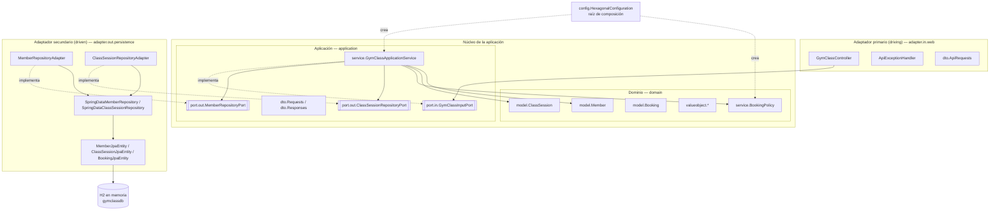
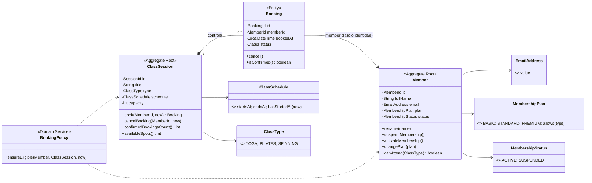
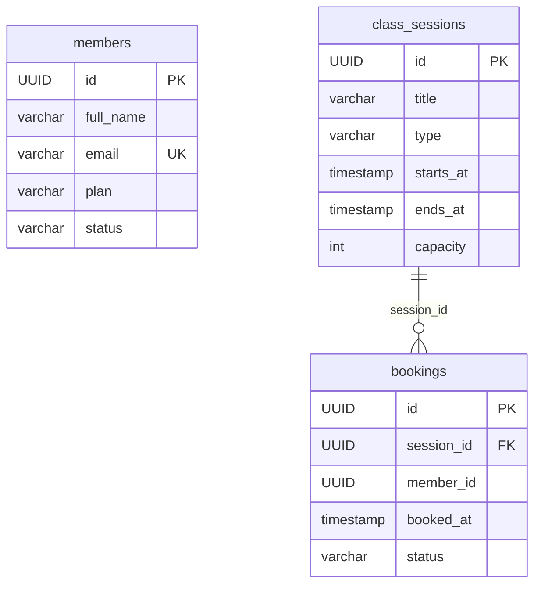
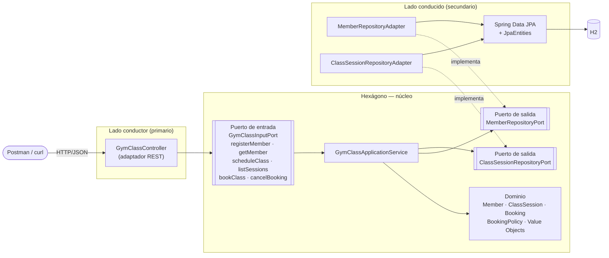
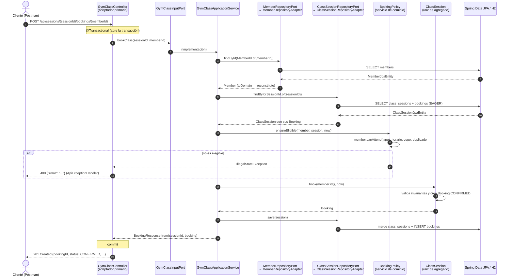
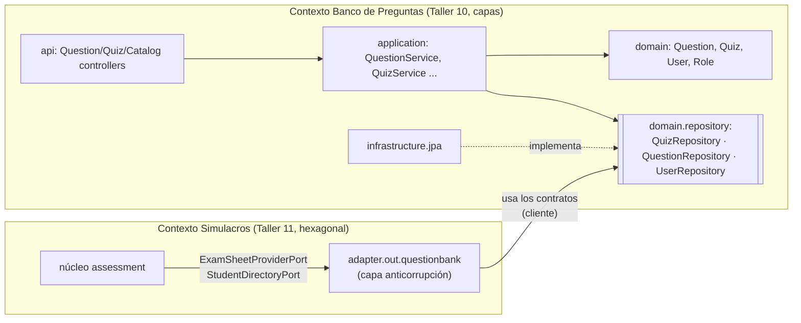
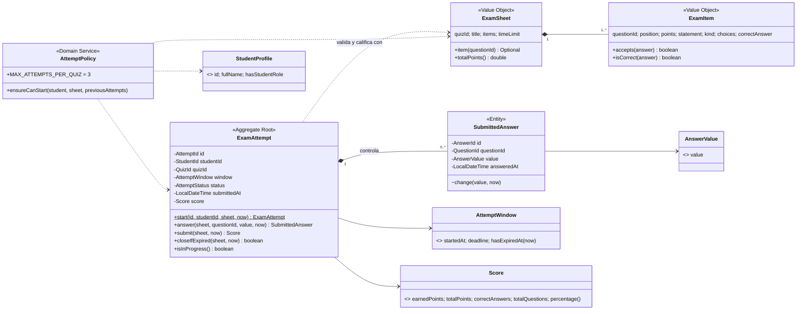
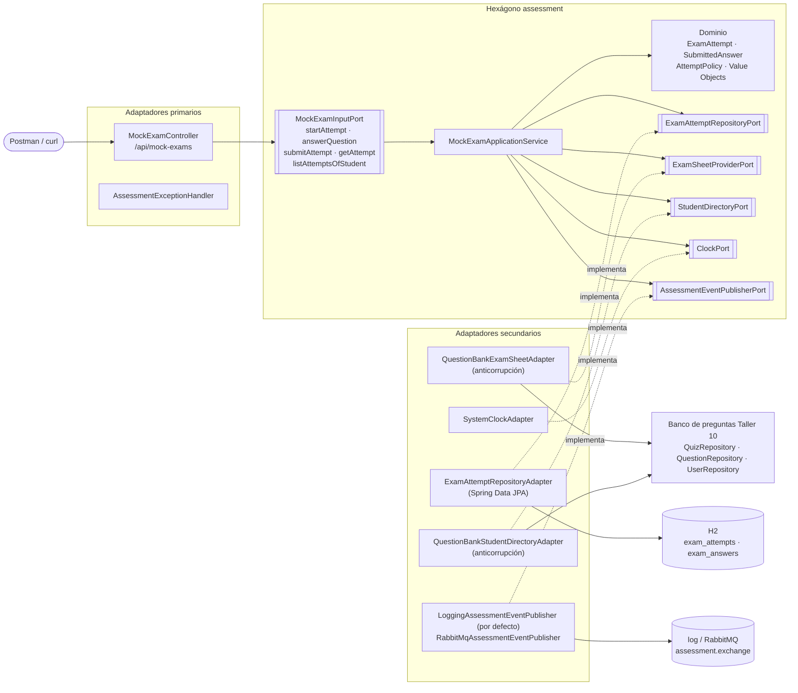
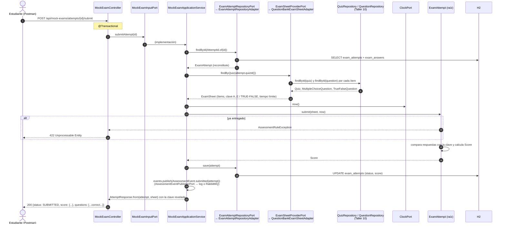
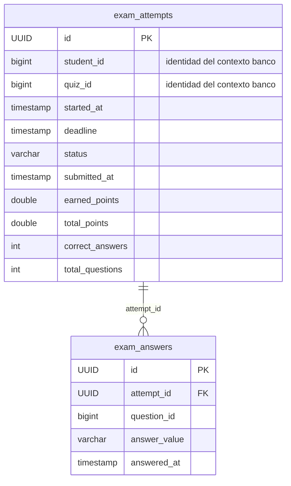

# Taller 11 — Domain-Driven Design y Arquitectura Hexagonal

Laboratorio de Ingeniería de Software II — Universidad del Cauca — 2026-2

Este informe tiene dos partes:

- **Partes I y II** (Actividades 1 a 7): análisis del demo `gymclass-ddd-hexagonal`
  (carpeta `../gymclass-ddd-hexagonal`).
- **Extensión propuesta**: el Banco de Preguntas Saber Pro del Taller 10 (`questionbank-jpa`) se
  amplía con un nuevo **bounded context de presentación de simulacros** (`assessment`), construido
  con DDD y arquitectura hexagonal siguiendo el mismo esquema del demo. El código del Taller 10 se
  conserva sin cambios y el nuevo contexto se conecta a él mediante puertos y adaptadores.

> DDD y arquitectura hexagonal son complementarios, pero no equivalentes: **DDD** modela el
> conocimiento del negocio (lenguaje ubicuo, entidades, objetos de valor, agregados, invariantes);
> **hexagonal** organiza las dependencias y los límites de interacción (puertos y adaptadores).

---

# Parte I. Comprensión del demo GymClass (DDD)

## Actividad 1. Reconocimiento de la arquitectura

El demo organiza el código alrededor de un **núcleo de aplicación** (dominio + aplicación) que no
depende de ninguna tecnología. Las tecnologías (HTTP, JPA, H2) quedan en los **adaptadores**, y
Spring solo actúa como **raíz de composición** (`config`).



| Capa / anillo | Paquete | Clases | Responsabilidad |
|---|---|---|---|
| Adaptador primario | `adapter.in.web` | `GymClassController`, `ApiExceptionHandler`, `dto.ApiRequests` | Recibe HTTP/JSON, valida el formato (Bean Validation), abre la transacción y llama al puerto de entrada. Traduce excepciones a códigos HTTP (400/404). |
| Puerto de entrada | `application.port.in` | `GymClassInputPort` | Contrato de los casos de uso que ofrece el núcleo, sin HTTP ni Spring. |
| Servicio de aplicación | `application.service` | `GymClassApplicationService` | Orquesta los casos de uso: carga agregados por los puertos de salida, invoca el dominio y pide guardar. No contiene reglas de negocio. |
| DTO de aplicación | `application.dto` | `Requests`, `Responses` | Comandos y respuestas independientes del framework. |
| Puertos de salida | `application.port.out` | `MemberRepositoryPort`, `ClassSessionRepositoryPort` | Lo que el núcleo necesita de la persistencia, sin decir cómo se implementa. |
| Dominio — modelo | `domain.model` | `Member`, `ClassSession`, `Booking` | Entidades y agregados con sus invariantes. |
| Dominio — objetos de valor | `domain.valueobject` | `MemberId`, `SessionId`, `BookingId`, `EmailAddress`, `ClassSchedule`, `MembershipPlan`, `MembershipStatus`, `ClassType` | Conceptos inmutables definidos por su valor, que se validan solos. |
| Dominio — servicio | `domain.service` | `BookingPolicy` | Regla de elegibilidad que involucra dos agregados (`Member` y `ClassSession`). |
| Adaptador secundario | `adapter.out.persistence` | `MemberRepositoryAdapter`, `ClassSessionRepositoryAdapter`, `*JpaEntity`, `SpringData*Repository` | Implementa los puertos de salida con Spring Data JPA y traduce entre modelo JPA y modelo de dominio. |
| Configuración | `config` | `HexagonalConfiguration` | Raíz de composición: crea `BookingPolicy` y `GymClassApplicationService` (que no son `@Component`) y los conecta con los adaptadores. |
| Arranque | raíz | `GymClassApplication` | Inicia Spring Boot. |

**Regla de dependencias:** `adapter.in → application.port.in ← application.service → application.port.out ← adapter.out`;
todas las flechas apuntan hacia el núcleo, y `domain` no importa nada de Spring, JPA, HTTP ni H2.

## Actividad 2. Ejecución del demo

Entorno verificado: OpenJDK 21 (compatible con el `java.version` 17 del `pom.xml`) y Maven 3.8.7.

```bash
cd gymclass-ddd-hexagonal
mvn clean test        # 2 pruebas de dominio (ClassSessionTest) -> BUILD SUCCESS
mvn spring-boot:run   # http://localhost:8080
```

Consola H2: `http://localhost:8080/h2-console` — JDBC URL `jdbc:h2:mem:gymclassdb`, usuario `sa`,
contraseña vacía. Al arrancar, Hibernate crea las tablas `members`, `class_sessions` y `bookings`.

La colección `docs/postman/GymClass.postman_collection.json` contiene las solicitudes en orden; guarda
automáticamente los identificadores en variables. Respuestas obtenidas en la ejecución (para cada
una se toma el pantallazo de Postman):

| # | Solicitud | Resultado | Regla o comportamiento que evidencia |
|---|---|---|---|
| 1 | `POST /api/members` (Alex, `BASIC`) | **201** `status: ACTIVE` | Un socio nuevo inicia con membresía activa. |
| 2 | `POST /api/members` (Sam, `PREMIUM`) | **201** | — |
| 3 | `POST /api/members` con `ALEX@example.com` | **400** `Email address is already registered` | El correo se normaliza (`EmailAddress`) y es único. |
| 4 | `POST /api/sessions` (Spinning, capacidad 1) | **201** `availableSpots: 1` | Programar clase. |
| 5 | `POST /api/sessions/{s}/bookings/{Alex}` | **400** `...does not include this class type` | Regla 2: el plan `BASIC` solo permite Yoga. |
| 6 | `POST /api/sessions/{s}/bookings/{Sam}` | **201** `status: CONFIRMED` | Reserva confirmada. |
| 7 | Repetir la reserva de Sam | **400** `Class session is full` | Reglas 3 y 4 (capacidad y no duplicar). |
| 8 | `GET /api/sessions` | **200** `confirmedBookings: 1, availableSpots: 0` | — |
| 9 | `DELETE /api/sessions/{s}/bookings/{Sam}` | **200** `availableSpots: 1` | Regla 6: cancelar libera el cupo. |
| 10 | `GET /api/members/{uuid inexistente}` | **404** `Member not found` | Recurso inexistente. |
| 11 | `POST /api/sessions` con fin antes del inicio | **400** `Class end time must be after its start time` | Invariante de `ClassSchedule`. |

> Espacio para pantallazos: Postman (solicitudes 1–11) y consola H2 (`SELECT * FROM BOOKINGS`, donde se
> ve la reserva en estado `CANCELLED` y la columna `session_id`).

## Actividad 3. Descubrir el dominio y el lenguaje ubicuo

**Contexto del negocio (bounded context): Gym Class Management.** Un gimnasio registra socios con un
plan de membresía, programa clases dirigidas con cupo limitado y gestiona las reservas de los socios
a esas clases.

| Término del negocio | Significado que tiene en la aplicación | Elemento del código |
|---|---|---|
| Member (socio) | Persona inscrita en el gimnasio, con nombre, correo, plan y estado de membresía. Raíz de su propio agregado. | `domain/model/Member.java` |
| Membership plan (plan) | Plan comercial que define a qué tipos de clase puede asistir el socio: `BASIC` (Yoga), `STANDARD` (Yoga, Pilates), `PREMIUM` (todas). | `domain/valueobject/MembershipPlan.java` (`allows`) |
| Membership status (estado de membresía) | `ACTIVE` o `SUSPENDED`; solo un socio activo puede reservar. | `domain/valueobject/MembershipStatus.java` |
| Email address (correo) | Correo válido y normalizado en minúsculas; identifica de forma única al socio en el registro. | `domain/valueobject/EmailAddress.java` |
| Class session (clase / sesión) | Clase dirigida programada: título, tipo, horario y cupo. Controla sus reservas. | `domain/model/ClassSession.java` |
| Class type (tipo de clase) | Actividad ofrecida: `YOGA`, `PILATES`, `SPINNING`. | `domain/valueobject/ClassType.java` |
| Class schedule (horario) | Intervalo inicio–fin con duración positiva; sabe si la clase ya empezó. | `domain/valueobject/ClassSchedule.java` (`hasStartedAt`) |
| Capacity (cupo) | Número máximo de reservas confirmadas de una clase. | `ClassSession.capacity`, `availableSpots()` |
| Booking (reserva) | Lugar que un socio ocupa en una clase; `CONFIRMED` o `CANCELLED`. | `domain/model/Booking.java` |
| Book a class (reservar) | Acción de ocupar un cupo; solo si la clase no ha empezado, hay cupo y el socio no tiene ya una reserva confirmada. | `ClassSession.book(...)`, `GymClassInputPort.bookClass` |
| Cancel booking (cancelar) | Liberar el cupo antes de que empiece la clase. | `ClassSession.cancelBooking(...)` |
| Eligibility (elegibilidad) | Condición del socio para reservar una clase concreta (membresía activa y plan compatible). | `domain/service/BookingPolicy.java`, `Member.canAttend` |
| Register member / Schedule class | Casos de uso de alta de socio y de programación de clase. | `GymClassInputPort.registerMember`, `scheduleClass` |
| Identidades | Identificadores UUID de socio, sesión y reserva, como objetos de valor. | `MemberId`, `SessionId`, `BookingId` |

## Actividad 4. Entidades, objetos de valor, agregados e invariantes



**Entidades** (tienen identidad que se conserva aunque cambie su estado):

| Entidad | Identidad | Comportamiento |
|---|---|---|
| `Member` | `MemberId` | Renombrar, suspender/activar membresía, cambiar plan, `canAttend`. No tiene setters públicos. |
| `ClassSession` | `SessionId` | Reservar, cancelar, contar reservas confirmadas y cupos libres. |
| `Booking` | `BookingId` | Cancelarse (una sola vez) e informar si está confirmada. |

**Objetos de valor** (inmutables, se comparan por valor y se validan en su constructor; todos son
`record` o `enum`): `MemberId`, `SessionId`, `BookingId` (UUID no nulo), `EmailAddress` (formato válido,
normalizado a minúsculas), `ClassSchedule` (fin posterior al inicio), `MembershipPlan` (con la regla
`allows`), `MembershipStatus`, `ClassType`.

**Agregados y raíces:**

| Agregado | Raíz | Contenido | Por qué |
|---|---|---|---|
| Member | `Member` | Solo el socio y sus objetos de valor. | Su ciclo de vida (plan, estado) es independiente de las clases. |
| ClassSession | `ClassSession` | La sesión y sus entidades hijas `Booking`. | El cupo y la unicidad de reservas solo se pueden garantizar si **todas** las reservas de una clase cambian a través de la clase. Por eso no existe `BookingRepository`: las reservas se guardan con su sesión. |

Entre agregados solo se guardan **identidades** (`Booking.memberId`), no referencias a objetos.

**Invariantes:**

| # | Invariante | Dónde se protege |
|---|---|---|
| 1 | Para reservar, la membresía debe estar activa. | `Member.canAttend` (llamado por `BookingPolicy`) |
| 2 | El plan restringe los tipos de clase. | `MembershipPlan.allows` |
| 3 | Una clase no supera su cupo (solo cuentan las reservas confirmadas). | `ClassSession.book`, `confirmedBookingsCount` |
| 4 | Un socio no tiene dos reservas confirmadas en la misma clase. | `ClassSession.book` (`hasConfirmedBookingFor`) |
| 5 | Las reservas se cierran cuando la clase empieza. | `ClassSession.book` + `ClassSchedule.hasStartedAt` |
| 6 | Solo se cancela antes de empezar; cancelar libera el cupo; no se cancela dos veces. | `ClassSession.cancelBooking`, `Booking.cancel` |
| 7 | Correo válido y único; nombre, título y datos obligatorios; cupo > 0; horario coherente. | `EmailAddress`, constructores de `Member`/`ClassSession`/`ClassSchedule`; la unicidad del correo la comprueba el servicio de aplicación con `existsByEmail` y la refuerza la restricción `UNIQUE` de la tabla. |

**Servicio de dominio:** `BookingPolicy.ensureEligible(member, session, now)`. La elegibilidad depende
de **dos agregados** (el plan y estado del socio y el tipo, horario y cupo de la clase), así que no
pertenece a ninguno de los dos. No tiene estado ni persistencia.

**Servicio de aplicación (no es de dominio):** `GymClassApplicationService` coordina, pero no decide reglas.

**Observaciones críticas del demo:**

- `BookingPolicy` repite comprobaciones que `ClassSession.book` ya hace (cupo, horario, duplicado).
  El agregado sigue siendo el guardián real; la política podría limitarse a la regla entre agregados
  (`member.canAttend(session.type())`). Por eso la solicitud 7 responde "full" y no "already booked".
- Las reglas se señalan con `IllegalStateException`/`IllegalArgumentException` genéricas; una excepción
  de dominio propia permitiría distinguirlas de errores técnicos (en la extensión se usa `AssessmentRuleException`).
- `suspendMembership`, `changePlan` y `rename` existen en el dominio pero no se exponen en el puerto de entrada.

## Actividad 5. Manejo de la persistencia

1. **El dominio no conoce la base de datos.** `Member`, `ClassSession` y `Booking` no tienen anotaciones
   JPA; el núcleo solo ve los puertos `MemberRepositoryPort` y `ClassSessionRepositoryPort`.
2. **Modelo de persistencia separado.** En `adapter.out.persistence` hay entidades JPA propias:
   `MemberJpaEntity` (tabla `members`, `email` único), `ClassSessionJpaEntity` (tabla `class_sessions`) y
   `BookingJpaEntity` (tabla `bookings`). Los enums se guardan como texto (`@Enumerated(STRING)`) y el
   objeto de valor `ClassSchedule` se "aplana" en dos columnas `starts_at` y `ends_at`.
3. **Traducción en el adaptador.** Cada entidad JPA tiene `fromDomain(...)` y `toDomain()`. Para volver al
   dominio se usan los métodos de fábrica `reconstitute(...)`, que rehacen el objeto con su estado
   guardado (por ejemplo, `status`) sin pasar por la lógica de creación.
4. **Un repositorio por agregado.** `ClassSessionJpaEntity` mapea `@OneToMany(cascade = ALL,
   orphanRemoval = true, fetch = EAGER) @JoinColumn(name = "session_id")` hacia `BookingJpaEntity`:
   el agregado se carga y se guarda **completo**, con sus reservas. La FK `bookings.session_id` la
   crea la relación unidireccional; `bookings.member_id` es solo una columna (no hay FK a `members`,
   porque es otro agregado).
5. **Spring Data como detalle.** `SpringDataMemberRepository` (con la consulta derivada
   `existsByEmail`) y `SpringDataClassSessionRepository` son internos al adaptador; no son puertos.
6. **Transacción.** La frontera transaccional está en el adaptador primario (`@Transactional` en el
   controlador). `save` hace `merge` porque el id (UUID) lo asigna el dominio.
7. **Configuración** (`application.yml`): H2 en memoria `jdbc:h2:mem:gymclassdb`, `ddl-auto: create-drop`
   (el esquema se crea al iniciar y se borra al cerrar), `show-sql: true` y consola H2 en `/h2-console`.
   Cambiar a PostgreSQL implica cambiar dependencia y `datasource`, sin tocar el núcleo.



---

# Parte II. Comprensión del demo GymClass (hexagonal)

## Actividad 6. Puertos de entrada y salida, adaptadores



| Elemento | Tipo | Clase | Dirección de la dependencia |
|---|---|---|---|
| Puerto de entrada (primario) | Interfaz que el núcleo **ofrece** | `GymClassInputPort` | El adaptador REST depende de él; el servicio lo implementa. |
| Puertos de salida (secundarios) | Interfaces que el núcleo **requiere** | `MemberRepositoryPort`, `ClassSessionRepositoryPort` | El servicio depende de ellos; los adaptadores JPA los implementan. |
| Adaptador primario (driving) | Inicia la interacción | `GymClassController` (+ `ApiExceptionHandler`) | Traduce HTTP → comando del puerto, y excepción → HTTP. |
| Adaptadores secundarios (driven) | El núcleo los usa a través del puerto | `MemberRepositoryAdapter`, `ClassSessionRepositoryAdapter` | Traducen dominio ↔ JPA. |

Consecuencia práctica: se puede agregar otro adaptador primario (CLI, consumidor de mensajes) que use
el mismo `GymClassInputPort`, o reemplazar los adaptadores JPA por uno en memoria para pruebas, **sin
cambiar el dominio ni el servicio**. En la extensión se demuestran ambas ideas.

## Actividad 7. Caso de uso de extremo a extremo: *Book Class*

**Caso de uso:** un socio reserva un cupo en una clase.
**Precondiciones:** el socio y la clase existen. **Éxito:** 201 con la reserva `CONFIRMED`.
**Fallos:** 404 si no existen; 400 si el socio no es elegible, la clase empezó, está llena o hay reserva duplicada.



---

# Parte III. Extensión propuesta: contexto de presentación de simulacros

## 1. Motivación y vínculo con lo desarrollado

En el Taller 10 se construyó `questionbank-jpa`: preguntas con su ciclo de vida
(`DRAFT → … → PUBLISHED`) y cuestionarios (`Quiz`) armados por un docente solo con preguntas publicadas.
El propio documento de diseño del Taller 10 dejó por fuera *"`Attempt`, `StudentAnswer` y `Result` (no
son parte de los casos de uso mínimos)"*, y el rol **STUDENT** existía pero no tenía ningún caso de uso
(*"responde preguntas y consulta sus resultados"*).

La extensión completa ese hueco con un **nuevo bounded context, `assessment`**, que modela la
presentación de simulacros con DDD y lo organiza como un hexágono, siguiendo los mismos paquetes del demo
GymClass. El contexto del Taller 10 (en capas) **no se modifica**: el nuevo contexto lo usa a través de
puertos de salida implementados por adaptadores que actúan como **capa anticorrupción**.

| GymClass (demo) | Simulacros (extensión) |
|---|---|
| Socio (`Member`) | Estudiante (`StudentProfile`, obtenido del contexto del banco) |
| Clase programada (`ClassSession`, raíz) | Intento de simulacro (`ExamAttempt`, raíz) |
| Reserva (`Booking`, entidad hija) | Respuesta (`SubmittedAnswer`, entidad hija) |
| Horario (`ClassSchedule`) | Ventana de tiempo (`AttemptWindow`) |
| Plan que restringe clases (`MembershipPlan.allows`) | Solo el rol STUDENT puede presentar (`StudentProfile.hasStudentRole`) |
| `BookingPolicy` (regla entre agregados) | `AttemptPolicy` (regla entre estudiante, simulacro e intentos previos) |
| `GymClassInputPort` | `MockExamInputPort` |
| 2 puertos de salida de repositorio | 5 puertos de salida: repositorio, proveedor de simulacros, directorio de estudiantes, reloj y publicador de eventos |

## 2. Mapa de contextos



Relación: **cliente–proveedor con capa anticorrupción**. El banco de preguntas es el proveedor
(*upstream*); el contexto de simulacros traduce `Quiz`/`Question`/`User` a su propio lenguaje
(`ExamSheet`, `ExamItem`, `StudentProfile`) y nunca importa el modelo del Taller 10 desde su núcleo
(lo verifica la prueba `HexagonalDependencyRuleTest`).

## 3. Lenguaje ubicuo del contexto de simulacros

| Término del negocio | Significado en la aplicación | Elemento del código |
|---|---|---|
| Simulacro / hoja de examen | Un cuestionario publicado visto como examen: preguntas en orden, puntos, opciones, clave de respuestas y tiempo límite. No se guarda: se obtiene del banco cada vez. | `domain/valueobject/ExamSheet.java` |
| Pregunta del simulacro | Pregunta traducida: enunciado, tipo, opciones con clave (`A`..`E`, `TRUE`/`FALSE`) y respuesta correcta. | `ExamItem`, `ExamChoice`, `ItemKind` |
| Intento | Una presentación de un simulacro por un estudiante. Raíz del agregado. | `domain/model/ExamAttempt.java` |
| Respuesta | Opción elegida por el estudiante para una pregunta del intento; se puede cambiar mientras el intento esté en curso. | `domain/model/SubmittedAnswer.java`, `AnswerValue` |
| Ventana / tiempo límite | Desde el inicio hasta el plazo (`deadline`) = suma de tiempos estimados de las preguntas (mínimo configurable, 20 min por defecto). | `AttemptWindow`, `ExamSheet.timeLimit` |
| Entregar | Cerrar el intento y calificarlo; es definitivo. | `ExamAttempt.submit` |
| Cierre por tiempo | Si el plazo pasó sin entregar, el intento se cierra solo con las respuestas dadas a tiempo. | `ExamAttempt.closeIfExpired` |
| Calificación | Puntos obtenidos, puntos totales, aciertos y porcentaje. | `domain/valueobject/Score.java` |
| Estado del intento | `IN_PROGRESS` o `SUBMITTED`. | `AttemptStatus` |
| Estudiante | Persona que presenta; lo que este contexto necesita saber del usuario del banco. | `StudentProfile`, `StudentId` |
| Elegibilidad para presentar | Reglas para iniciar un intento. | `domain/service/AttemptPolicy.java` |

## 4. Modelo DDD



- **Entidades:** `ExamAttempt` (identidad `AttemptId`, UUID) y `SubmittedAnswer` (identidad `AnswerId`).
- **Objetos de valor:** `AttemptId`, `AnswerId`, `StudentId`, `QuizId`, `QuestionId`, `AnswerValue`,
  `AttemptWindow`, `Score`, `AttemptStatus`, `ItemKind`, `ExamChoice`, `ExamItem`, `ExamSheet`, `StudentProfile`.
- **Agregado:** `ExamAttempt` es la raíz y controla sus `SubmittedAnswer`; el constructor de
  `SubmittedAnswer` y su método `change` son de paquete, de modo que solo la raíz puede crearlas o
  cambiarlas. Hay un solo repositorio (`ExamAttemptRepositoryPort`), no uno de respuestas.
- **Servicio de dominio:** `AttemptPolicy`, porque la regla para iniciar involucra al estudiante, al
  simulacro y a los intentos previos.

**Invariantes:**

| # | Invariante | Dónde se protege |
|---|---|---|
| A1 | Solo un usuario con rol STUDENT puede presentar un simulacro. | `AttemptPolicy` |
| A2 | Un simulacro sin preguntas no se puede presentar. | `AttemptPolicy` |
| A3 | Un estudiante tiene como máximo un intento en curso por simulacro. | `AttemptPolicy` |
| A4 | Máximo 3 intentos por simulacro y estudiante. | `AttemptPolicy.MAX_ATTEMPTS_PER_QUIZ` |
| A5 | Solo se responden preguntas del simulacro y con una de sus opciones. | `ExamAttempt.answer` + `ExamItem.accepts` |
| A6 | No se responde después del plazo ni después de entregar. | `ExamAttempt.answer` + `AttemptWindow.hasExpiredAt` |
| A7 | Una respuesta por pregunta; responder de nuevo reemplaza la anterior. | `ExamAttempt.answer` |
| A8 | La entrega es única y definitiva; las no respondidas cuentan como incorrectas. | `ExamAttempt.submit` |
| A9 | La clave de respuestas solo se revela después de entregar. | `Responses.AttemptResponse.from` |
| A10 | Los puntos obtenidos están entre 0 y el total. | `Score` |

## 5. Arquitectura hexagonal de la extensión



Composición: `assessment/config/AssessmentConfiguration` crea `AttemptPolicy` y
`MockExamApplicationService` (clases sin anotaciones de Spring) y los conecta con los adaptadores.

Diferencias respecto al demo, que muestran que un puerto de salida no es solo "un repositorio":

- `ExamSheetProviderPort` y `StudentDirectoryPort` obtienen datos de **otro módulo** (el Taller 10), no de una tabla propia.
- `ClockPort` aísla el tiempo; así las pruebas controlan los plazos sin esperar (`FixedClock`).
- `AssessmentEventPublisherPort` publica los eventos de dominio `ATTEMPT_STARTED` y `ATTEMPT_SUBMITTED`
  (`domain/event/AssessmentEvent`). Tiene **dos adaptadores intercambiables por configuración**, sin
  tocar el núcleo: `LoggingAssessmentEventPublisher` (por defecto, `questionbank.assessment.events=log`)
  y `RabbitMqAssessmentEventPublisher` (`questionbank.assessment.events=rabbitmq`, exchange de tipo
  *topic* `assessment.exchange`, claves `assessment.attempt_started` / `assessment.attempt_submitted`).
  Si el broker no está disponible, registra una advertencia y el caso de uso continúa.
- `MockExamApplicationServiceTest` reemplaza los cinco adaptadores por implementaciones en memoria
  (ejercicio 4 del README del demo): el servicio no se entera.

## 6. Caso de uso de extremo a extremo: *Entregar un intento*



## 7. Persistencia de la extensión

Usa la misma base H2 (`jdbc:h2:mem:questionbank`) del Taller 10, con tablas propias. Las columnas
`student_id` y `quiz_id` **no tienen FK** hacia `users` o `quizzes`: son identidades de otro contexto,
igual que `bookings.member_id` en el demo. El objeto de valor `Score` se guarda en cuatro columnas
anulables y `AttemptWindow` en dos.



## 8. API REST de la extensión

| Método | Ruta | Cuerpo | Respuesta |
|---|---|---|---|
| POST | `/api/mock-exams/attempts` | `{"quizId":1,"studentId":5}` | 201 intento `IN_PROGRESS` con preguntas y opciones, sin clave |
| PUT | `/api/mock-exams/attempts/{attemptId}/answers/{questionId}` | `{"answer":"B"}` | 200 intento actualizado |
| POST | `/api/mock-exams/attempts/{attemptId}/submit` | — | 200 intento `SUBMITTED` con `score` y clave |
| GET | `/api/mock-exams/attempts/{attemptId}` | — | 200 intento (si venció, se cierra) |
| GET | `/api/mock-exams/students/{studentId}/attempts` | — | 200 lista de intentos, el más reciente primero |

Errores: 400 cuerpo inválido o id mal formado; 404 intento, simulacro o estudiante inexistente;
422 regla de negocio. Con los datos de ejemplo: cuestionario `1` (pregunta 1 → `B`, pregunta 2 → `FALSE`),
estudiante `5` (juan.diaz) y docente `4` (para probar el rechazo).

Ejecución verificada:

| # | Solicitud | Resultado |
|---|---|---|
| 1 | `POST /attempts` quiz 1, estudiante 5 | 201 `IN_PROGRESS`, `totalQuestions: 2`, `correctAnswer: null` |
| 2 | `PUT /answers/1` `B` | 200 |
| 3 | `PUT /answers/2` `TRUE` | 200 |
| 4 | `POST /submit` | 200 `SUBMITTED`, 1/2 puntos, 50 %, pregunta 2 `correct: false` con clave `FALSE` |
| 5 | `PUT /answers/1` después de entregar | 422 `Attempt ... was already submitted` |
| 6 | `POST /attempts` con el docente 4 | 422 `User 4 is not a STUDENT` |
| 7 | `GET /students/5/attempts` | 200 `[{status: SUBMITTED, percentage: 50.0}]` |

## 9. Reutilización del proyecto final (`proyecto-saberpro-ing-software-II`)

El puerto de eventos reutiliza el diseño de mensajería de `banco-service` (Iteración 2):

| `banco-service` | Extensión (Taller 11) |
|---|---|
| `IQuestionEventPublisher` (interfaz en `messaging`) | `AssessmentEventPublisherPort` (puerto de salida en `application.port.out`) |
| `QuestionEvent` (record con fábricas `created`, `stateChanged`) | `AssessmentEvent` (evento de dominio con fábricas `started`, `submitted`) |
| `RabbitMQQuestionEventPublisher` (exchange *topic*, JSON, advertencia si no hay broker) | `RabbitMqAssessmentEventPublisher` (mismo comportamiento) |
| Un único publicador fijo en `BancoConfig` | Dos adaptadores elegidos por propiedad; el núcleo no cambia |

La diferencia muestra el aporte de la arquitectura hexagonal: en `banco-service` la interfaz vivía
junto a su implementación; aquí es un contrato del núcleo, y RabbitMQ es solo uno de sus adaptadores.

## 10. Pruebas automatizadas

`mvn clean test` → **57 pruebas, 0 fallos** (37 del Taller 10 + 20 nuevas):

| Clase | Tipo | Qué verifica |
|---|---|---|
| `assessment/domain/ExamAttemptTest` (8) | Unitaria de dominio, sin Spring | Invariantes A5–A8, plazo, reemplazo de respuesta, cierre por tiempo, cálculo de la nota. |
| `assessment/domain/AttemptPolicyTest` (5) | Unitaria de dominio | Invariantes A1–A4. |
| `assessment/application/MockExamApplicationServiceTest` (3) | Aplicación con adaptadores falsos en memoria, reloj fijo y publicador que guarda los eventos en una lista | Flujo completo, eventos emitidos, recursos inexistentes, cierre de intentos vencidos. |
| `assessment/adapter/MockExamApiIntegrationTest` (2) | Integración `@SpringBootTest` + MockMvc + H2 | El simulacro se arma con los casos de uso del Taller 10 y se presenta por REST; traducción de errores a 400/404/422. |
| `assessment/architecture/HexagonalDependencyRuleTest` (2) | Arquitectura | `domain` y `application` no importan Spring, JPA, adaptadores ni el modelo del Taller 10. |

---

# Lista de verificación de entregables

| Entregable | Dónde |
|---|---|
| Modelo DDD (entidades, objetos de valor, agregados, invariantes, servicios) | Actividad 4 (demo) y Parte III §3–4 (extensión) |
| Arquitectura hexagonal (núcleo, puertos, adaptadores, dependencias) | Actividades 1 y 6 (demo) y Parte III §5 (extensión) |
| Diagrama de secuencia | Actividad 7 (*Book Class*) y Parte III §6 (*Entregar intento*) |
| Configuración de Spring Boot y H2 | Actividades 2 y 5; `src/main/resources/application.properties` |
| Pruebas automatizadas y de integración | Parte III §9 |
| Evidencias de ejecución (Postman) | Actividad 2 y Parte III §8; colecciones en `docs/postman/` |
| Extensión propuesta | Parte III, paquete `co.edu.unicauca.questionbank.assessment` |
