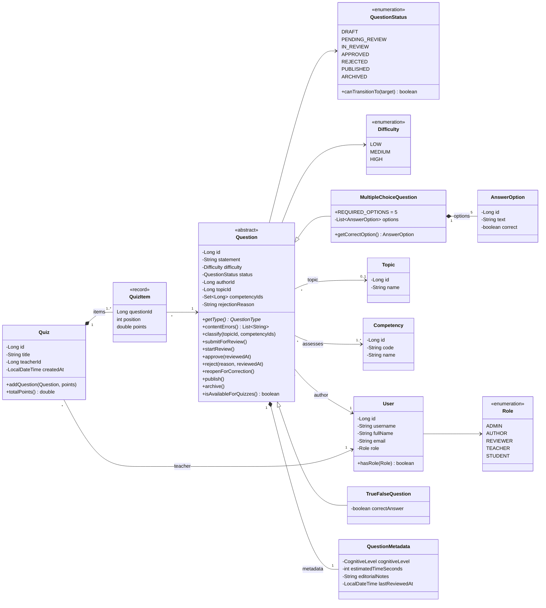
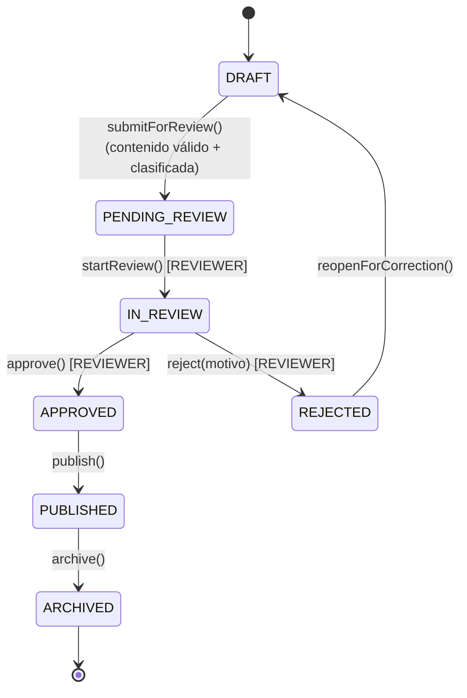
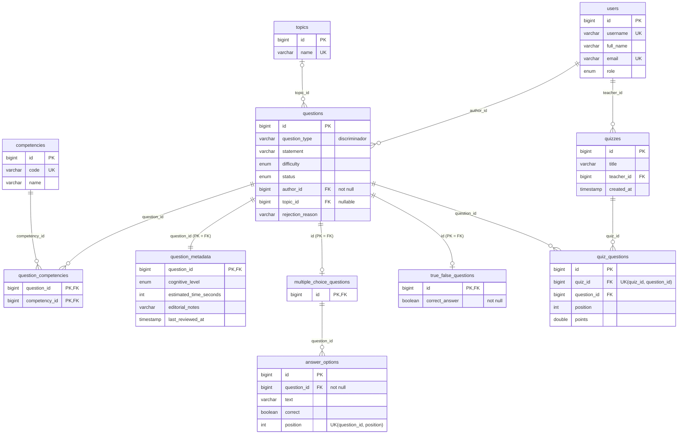

# Taller 10 — Partes II y III: diseño del Banco de Preguntas Saber Pro

Laboratorio de Ingeniería de Software II — Universidad del Cauca — 2026-2

## 1. Alcance (Punto 2)

Se implementaron las entidades necesarias para los cinco casos de uso obligatorios y para
demostrar los cuatro tipos de relación y la herencia:

| Grupo | Entidades implementadas | Se dejaron por fuera (justificación) |
|---|---|---|
| Usuarios | `User`, `Role` | `UserProfile`: no aporta a ningún caso de uso pedido. |
| Clasificación | `Topic`, `Competency` | `QuestionTag`: cumpliría el mismo papel que `Competency` (muchos a muchos). |
| Banco | `Question`, `MultipleChoiceQuestion`, `TrueFalseQuestion`, `AnswerOption`, `QuestionMetadata` | — |
| Revisión | Estados `IN_REVIEW`, `APPROVED`, `REJECTED` y motivo de rechazo en `Question`; fecha de última revisión en `QuestionMetadata` | `Review`, `ReviewCriterion` y `QuestionHistory` son el alcance del Review Service del Taller 9. |
| Evaluación | `Quiz`, `QuizItem` (entidad asociativa) | `Attempt`, `StudentAnswer` y `Result` no son parte de los casos de uso mínimos. |

Actores que el sistema valida: **AUTHOR** crea, clasifica y envía a revisión; **REVIEWER** toma,
aprueba o rechaza; **TEACHER** crea cuestionarios. **ADMIN** y **STUDENT** existen como roles.

## 2. Diagrama de clases UML del dominio (Punto 3)

El dominio no tiene anotaciones JPA. Las asociaciones entre agregados se guardan como
identificadores (`authorId`, `topicId`, `competencyIds`, `questionId`).



**Restricciones del dominio:**
- Una pregunta de selección múltiple tiene exactamente 5 opciones (4 distractores y 1 respuesta
  correcta), sin textos vacíos ni repetidos.
- Toda pregunta necesita enunciado y autor.
- Para enviar a revisión se exige contenido válido, un tema y al menos una competencia.
- Las transiciones están definidas en `QuestionStatus.canTransitionTo`.
- Un rechazo exige motivo.
- Solo se reclasifican borradores.
- En un `Quiz` solo entran preguntas `PUBLISHED` y sin repetir.

### Ciclo de vida



## 3. Modelo relacional (tablas generadas por Hibernate)



## 4. Los cuatro tipos de relación (Punto 4)

### 4.1 Uno a uno — `Question` y `QuestionMetadata`
- **Propietario:** `QuestionMetadataRecord`, que tiene `@OneToOne` con `@MapsId`.
  `QuestionRecord.metadata` es el lado inverso (`mappedBy = "question"`, `cascade = ALL`,
  `orphanRemoval = true`).
- **Clave foránea:** `question_metadata.question_id`, que es al mismo tiempo PK y FK hacia
  `questions.id` (PK compartida).
- **¿Obligatoria u opcional?** En el dominio es obligatoria: si el autor no envía metadatos se
  usan valores por defecto, y el mapper siempre crea la fila. En la base de datos, la metadata
  depende de la pregunta (`optional = false`) y no al revés, porque la fila de `questions` se
  inserta primero.
- **Cómo se garantiza un solo registro por pregunta:** como la PK de la metadata es el id de la
  pregunta, una segunda fila viola la clave primaria. Lo demuestra la prueba
  `primaryKeyPreventsTwoMetadataRowsForOneQuestion`.

### 4.2 Uno a muchos — `Question` y `AnswerOption`
- **Representación:** `MultipleChoiceQuestionRecord.options` (`@OneToMany(mappedBy = "question")`,
  `@OrderBy("position")`) y `AnswerOptionRecord.question` (`@ManyToOne(optional = false)`, que es el
  lado propietario).
- **Opción sin pregunta:** `question_id` es `NOT NULL` y es FK a `multiple_choice_questions`, no a
  `questions`. Así ni siquiera se puede colgar una opción de una pregunta Verdadero/Falso. Lo
  prueba `foreignKeyRejectsOptionWithoutQuestion`.
- **Número de opciones y respuesta correcta:** lo controla el dominio
  (`MultipleChoiceQuestion.collectContentErrors`): 5 opciones y exactamente 1 correcta. La BD
  agrega `UNIQUE(question_id, position)`.
- **Al eliminar la pregunta:** `cascade = ALL` y `orphanRemoval = true` borran las opciones y la
  metadata (prueba `deletingAQuestionRemovesItsOptionsAndMetadata`). La aplicación solo permite
  eliminar preguntas en `DRAFT`.
- **Detalle técnico:** al editar, las opciones se actualizan en su lugar
  (`QuestionMapper.syncOptions`) en vez de reemplazar la colección. Hibernate ejecuta los `INSERT`
  antes que los `DELETE` en el *flush*, así que reemplazar violaría temporalmente la restricción
  única. Lo prueba `optionsAreUpdatedInPlace`.

### 4.3 Muchos a uno — `Question` y `User` (también `Question` y `Topic`)
- **Propietario:** `QuestionRecord`, con `@ManyToOne(optional = false)` y
  `@JoinColumn(name = "author_id", nullable = false)`. Para el tema: `topic_id` *nullable*,
  porque un borrador puede no estar clasificado todavía.
- **Reglas que impiden un autor inexistente:**
  1. `QuestionService` verifica que el usuario exista y tenga rol `AUTHOR`; si no, responde 404 o
     422.
  2. `QuestionRepositoryJpa.save` resuelve el `UserRecord` y lanza una excepción si no existe.
  3. La FK `questions.author_id → users.id` rechaza el dato aunque alguien escriba directamente en
     la BD (prueba `foreignKeyRejectsQuestionWithUnknownAuthor`).

### 4.4 Muchos a muchos — `Question` y `Competency`
- **Tabla intermedia:** `question_competencies`.
- **Claves foráneas:** `question_id → questions.id` y `competency_id → competencies.id`, que juntas
  forman la PK compuesta.
- **¿Atributos adicionales?** No. Por eso se mantiene un `@ManyToMany` directo (`Set`), con
  `QuestionRecord` como lado propietario.
- **Reto de diseño:** la relación `Quiz`–`Question` sí necesita atributos propios (posición y
  puntaje). Por eso se modeló con la entidad asociativa `QuizQuestionRecord`: dos `@ManyToOne`
  (hacia el quiz y hacia la pregunta) y un `@OneToMany` desde `QuizRecord`, con
  `UNIQUE(quiz_id, question_id)`. Si el porcentaje de contribución de cada competencia se volviera
  un requisito, se haría lo mismo con una entidad `QuestionCompetency(question, competency,
  weight)`.

## 5. Herencia (Punto 5)

Hay dos jerarquías paralelas:

- **Dominio:** `Question` (abstracta), con las subclases `MultipleChoiceQuestion` y
  `TrueFalseQuestion`.
- **Persistencia:** `QuestionRecord` (abstracta, `@Inheritance(strategy = JOINED)` y
  `@DiscriminatorColumn("question_type")`), con `MultipleChoiceQuestionRecord` y
  `TrueFalseQuestionRecord`.

| Estrategia | Ventajas para este sistema | Desventajas para este sistema |
|---|---|---|
| `SINGLE_TABLE` | Las consultas por estado, autor o competencia no necesitan joins. Es la más rápida. | `correct_answer` debe ser *nullable*, así que no se puede exigir que una pregunta V/F lo tenga. La FK de `answer_options` tendría que apuntar a la tabla general, lo que permitiría opciones en preguntas V/F. La tabla se llena de columnas *nullable* con cada tipo nuevo. |
| **`JOINED` (elegida)** | Cada subtipo tiene su tabla con sus propias restricciones (`correct_answer NOT NULL`). `answer_options` apunta solo a preguntas de selección múltiple. Agregar un tipo nuevo es crear una tabla sin tocar las demás. Las consultas sobre los datos comunes (estado, autor, competencias) solo usan `questions`. | Cargar una pregunta completa requiere un join con la tabla de su subtipo. Un insert son dos sentencias. |
| `TABLE_PER_CLASS` | No hay joins al leer un tipo concreto. | Las columnas comunes se repiten. Las consultas polimórficas (que son las más frecuentes aquí) usan `UNION`. No se pueden crear FKs hacia "una pregunta cualquiera" (`quiz_questions`, `question_metadata`). No permite `IDENTITY`. |

**Justificación:** el sistema debe incorporar tipos de pregunta nuevos con atributos y reglas
distintas, y la integridad es importante: opciones solo en selección múltiple, valor de verdad
obligatorio. `JOINED` permite expresar esas restricciones en la base de datos. El costo del join es
bajo, porque las tablas de los subtipos son pequeñas.

## 6. Arquitectura en capas (Punto 6)

```
co.edu.unicauca.questionbank
├── api/                      QuestionController, QuizController, CatalogController,
│   └── dto/                  GlobalExceptionHandler, peticiones y respuestas JSON
├── application/              QuestionService, ReviewService, QuizService, CatalogService
├── domain/
│   ├── model/                Question, MultipleChoiceQuestion, TrueFalseQuestion, AnswerOption,
│   │                         QuestionMetadata, User, Topic, Competency, Quiz, QuizItem, enums
│   ├── repository/           QuestionRepository, UserRepository, TopicRepository,
│   │                         CompetencyRepository, QuizRepository (contratos)
│   └── exception/            BusinessRuleException, InvalidQuestionException,
│                             InvalidStatusTransitionException
├── infrastructure/jpa/
│   ├── record/               *Record (las únicas clases con anotaciones JPA)
│   ├── repository/           Spring*DataRepository (extienden JpaRepository)
│   ├── mapper/               QuestionMapper, QuizMapper, CatalogMapper
│   └── *RepositoryJpa        implementaciones de los contratos
└── config/                   SampleDataLoader (datos de ejemplo usando los servicios)
```

Las reglas de dependencia se cumplen: `domain` no importa ni Spring ni `jakarta.persistence`, y
`application` no conoce `JpaRepository` ni los *records* (se puede comprobar con `grep`).

**Reflexión del Punto 7:** `QuestionService` invoca `QuestionRepository` y no
`SpringQuestionDataRepository` por estas razones:

1. El contrato habla en términos del dominio: devuelve `Question` y no `QuestionRecord`, y tiene
   operaciones como `findPublishedByCompetency`.
2. El servicio no puede manipular entidades gestionadas por error (cambios que se escriben sin
   querer al hacer *flush*, proxies *lazy*).
3. Las pruebas del servicio usan repositorios en memoria (`QuestionAndQuizServiceTest`).
4. Cambiar JPA por otra tecnología solo afecta a `infrastructure`.

## 7. Casos de uso (Punto 8)

| # | Caso de uso | Servicio | Endpoint |
|---|---|---|---|
| 1 | Crear una pregunta | `QuestionService.createMultipleChoice / createTrueFalse` | `POST /api/questions` |
| 2 | Consultar preguntas | `findById`, `findAll`, `findByAuthor`, `findByStatus`, `findPublishedByCompetency` | `GET /api/questions/{id}`, `GET /api/questions?authorId=|status=|competencyId=` |
| 3 | Clasificar una pregunta | `QuestionService.classify` | `PUT /api/questions/{id}/classification` |
| 4 | Enviar a revisión | `QuestionService.submitForReview` | `POST /api/questions/{id}/submit` |
| 5 | Crear un cuestionario | `QuizService.createQuiz` | `POST /api/quizzes` |
| + | Revisar, aprobar, rechazar | `ReviewService.startReview / approve / reject` | `POST /api/questions/{id}/start-review / approve / reject` |
| + | Corregir, publicar, archivar, eliminar borrador | `QuestionService.reopenForCorrection / publish / archive / deleteDraft` | `POST .../reopen / publish / archive`, `DELETE /api/questions/{id}` |

Los cambios de estado nunca escriben una columna directamente:

1. El servicio carga la pregunta.
2. El dominio valida la transición (`InvalidStatusTransitionException`) y sus condiciones
   (`InvalidQuestionException`).
3. El repositorio guarda, todo dentro de una transacción (`@Transactional`).

Crear un quiz también es atómico: si una de las preguntas no está publicada, no se guarda nada.

## 8. Pruebas (Punto 9)

`mvn test` ejecuta 37 pruebas:

| Requisito de la guía | Pruebas |
|---|---|
| Las entidades se guardan y recuperan | `QuestionRepositoryJpaTest.savesAndReadsBackAllRelationships`, `statusChangesArePersistedAndQueryable` |
| Las relaciones se conservan al consultar | `savesAndReadsBackAllRelationships` (cubre los 4 tipos), `quizKeepsItsQuestionsInOrder` |
| La herencia persiste y recupera cada tipo | `inheritanceStoresEachTypeInItsOwnTable` (verifica también las tablas con SQL nativo) |
| FKs y restricciones impiden relaciones inválidas | `foreignKeyRejectsQuestionWithUnknownAuthor`, `foreignKeyRejectsOptionWithoutQuestion`, `primaryKeyPreventsTwoMetadataRowsForOneQuestion`, `questionUsedInAQuizCannotBeDeleted`, `uniqueConstraintPreventsDuplicatedUsernames`, `repositoryRejectsUnknownAuthor` |
| El ciclo de vida impide usar preguntas no publicadas en cuestionarios | `QuizTest.unpublishedQuestionIsRejected`, `QuestionAndQuizServiceTest.quizAcceptsOnlyPublishedQuestions`, `QuestionBankApiIntegrationTest.questionGoesFromCreationToQuiz` |
| Los contratos se prueban sin acoplarse a JPA | `QuestionAndQuizServiceTest` con `InMemoryRepositories`; `QuestionLifecycleTest`, `MultipleChoiceQuestionTest` y `QuizTest` son dominio puro |
| Casos de error | Transiciones inválidas, contenido inválido, roles incorrectos, recursos inexistentes (404) y violaciones de restricciones |

## 9. Preguntas de reflexión para la sustentación

**1. Ventajas y desventajas de dos modelos (dominio y persistencia).**

*Ventajas:*
- El dominio expresa reglas (ciclo de vida, 5 opciones) sin restricciones de JPA (constructor
  vacío, campos mutables, colecciones gestionadas).
- El esquema puede cambiar sin tocar el negocio.
- Las pruebas del dominio y de los servicios no necesitan base de datos.
- Las entidades gestionadas no se filtran a la API.

*Desventajas:*
- Hay más clases y mapeo manual.
- Las asociaciones se resuelven por id en los repositorios.
- Cada lectura implica una conversión.
- Hay que cuidar detalles como actualizar colecciones en su lugar (`syncOptions`).

**2. ¿Qué cambiaría si se dejara de usar JPA?**
Solo `infrastructure`: nuevas implementaciones de los cinco contratos (por ejemplo con JDBC
`JdbcTemplate` o MongoDB), nuevos mappers y la configuración. Dominio, servicios, controladores y
las pruebas con repositorios en memoria quedan iguales.

**3. ¿`@ManyToMany` directo o entidad asociativa?**
- Directo, cuando la relación es solo un vínculo sin datos propios (`question_competencies`).
- Entidad asociativa, cuando la relación tiene atributos (posición y puntaje en `quiz_questions`,
  peso de una competencia), un ciclo de vida propio, o cuando se quiere consultarla o auditarla
  como un concepto en sí.

**4. Problemas con asociaciones LAZY fuera de una transacción.**
- Se produce `LazyInitializationException` al acceder a la colección o al proxy cuando la sesión ya
  se cerró. Con `spring.jpa.open-in-view=false`, esto ocurre en el controlador o al serializar.
- El problema N+1: una consulta por cada elemento de una lista.
- Los proxies tienen un tipo distinto del real. Con herencia, un proxy de `QuestionRecord` no es
  `instanceof MultipleChoiceQuestionRecord`.

En este proyecto, los repositorios son `@Transactional(readOnly = true)` y convierten a dominio
dentro de la transacción, y el mapper usa `Hibernate.unproxy`.

**5. Estrategia de herencia con muchos tipos de preguntas con atributos y reglas distintos.**
`JOINED`: cada tipo agrega su tabla con sus restricciones sin llenar una tabla única de columnas
*nullable*. `TABLE_PER_CLASS` hace costosas las consultas polimórficas e impide FKs comunes, y
`SINGLE_TABLE` pierde integridad a medida que crecen los tipos.

**6. ¿Por qué persistir una pregunta y validar su ciclo de vida son responsabilidades distintas?**
La regla "DRAFT solo pasa a PENDING_REVIEW si está completa y clasificada" pertenece al negocio y
debe cumplirse sin importar dónde se guarde la pregunta. Si estuviera en el repositorio o en un
`UPDATE` de columna, se duplicaría en cada tecnología y podría saltarse. El dominio decide **si**
el cambio es válido y el repositorio solo decide **cómo** guardarlo. Así cada responsabilidad se
prueba por separado (`QuestionLifecycleTest` frente a `QuestionRepositoryJpaTest`).
