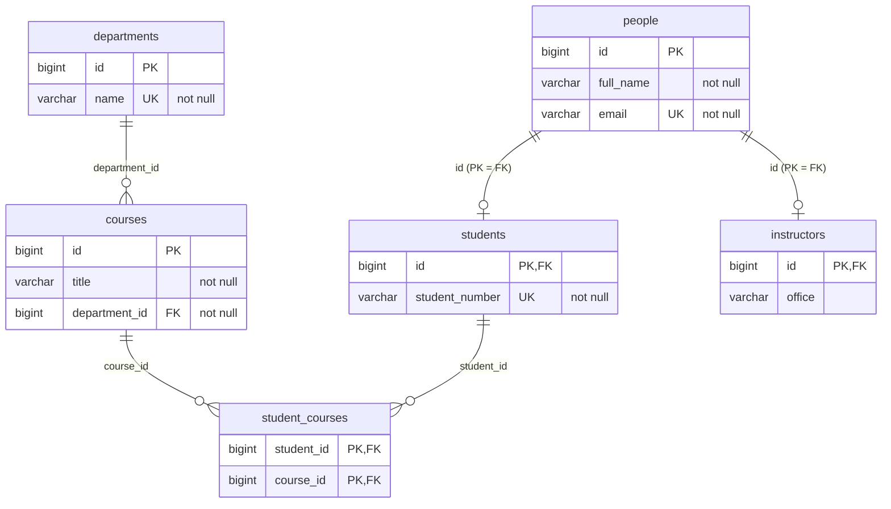

# Taller 10 — Parte I: análisis del demo `jpa-clean-persistence-demo`

Laboratorio de Ingeniería de Software II — Universidad del Cauca — 2026-2

El demo es una aplicación Spring Boot 3.4.5 (Java 17, Spring Data JPA, H2) organizada en capas
(`api`, `application`, `domain`, `infrastructure.jpa`). Las clases de dominio son objetos Java
planos; las anotaciones JPA viven únicamente en los *records* del paquete
`infrastructure.jpa.record`.

## Actividad 1.1 — Reconocimiento de la arquitectura

| Elemento | Archivo o clase | Responsabilidad |
|---|---|---|
| Presentación | `SchoolController` | Expone los endpoints REST (`/api/departments`, `/api/courses`, `/api/students`, `/api/students/{id}/courses/{id}`). Recibe el JSON en *records* de petición (`NameRequest`, `CourseRequest`, `StudentRequest`) y delega cada operación en `SchoolService`. No tiene reglas de negocio ni conoce JPA. |
| Aplicación | `SchoolService` | Coordina los casos de uso: crear departamento, curso y estudiante, matricular y listar. Define los límites transaccionales (`@Transactional` en la clase, `readOnly = true` en las consultas). Solo depende de los contratos `StudentRepository`, `CourseRepository` y `DepartmentRepository`. |
| Dominio | `Student`, `Course`, `Department` (y `Person`, `Instructor`) | Representan los conceptos del negocio escolar como objetos Java puros. Las asociaciones se expresan con identificadores (`Course.departmentId`, `Student.courseIds`) y no con referencias a entidades JPA. `Person` es la base abstracta de `Student` e `Instructor`. |
| Contrato de repositorio | `StudentRepository` | Define las operaciones de persistencia en términos del dominio: `save`, `findById`, `findAll` y `enrollInCourse(studentId, courseId)`. No usa ningún tipo de Spring ni de JPA. |
| Implementación concreta | `StudentRepositoryJpa` | Implementa el contrato con `SpringStudentDataRepository` y `SpringCourseDataRepository`. Convierte con `DomainMapper`. En `enrollInCourse` carga ambos *records* dentro de una transacción, agrega el curso a la colección del lado propietario (`StudentRecord.courses`) y guarda; Hibernate inserta la fila en `student_courses`. |
| Modelo JPA | `StudentRecord` | Entidad JPA de la tabla `students`. Hereda de `PersonRecord` (estrategia `JOINED`) y es el lado propietario de la relación muchos a muchos con `CourseRecord` (tabla `student_courses`). |
| Conversión de modelos | `DomainMapper` | Traduce entre *records* JPA y objetos de dominio. Es necesaria porque hay dos modelos distintos para el mismo concepto. Además evita que entidades gestionadas, proxies `LAZY` o colecciones de Hibernate salgan de la capa de infraestructura. |

### Preguntas

**1. ¿Qué ocurriría si se agregara `@Entity` directamente a la clase de dominio `Student`?**
El dominio tendría que importar `jakarta.persistence`, lo que rompe la regla del taller y acopla
el modelo de negocio a una tecnología. En concreto:

- Las decisiones de base de datos (tabla, columnas, generación de IDs, herencia con
  `@Inheritance` en `Person`) quedarían dentro del dominio. Cualquier cambio de esquema obligaría
  a modificar las clases de negocio.
- JPA impone restricciones: un constructor sin argumentos, campos no `final` y colecciones de
  entidades. `courseIds: List<Long>` tendría que convertirse en `Set<Course>` gestionado por
  Hibernate.
- Aparecerían proxies y colecciones `LAZY` en el dominio. Si se leen fuera de una transacción se
  produce `LazyInitializationException`, por ejemplo cuando Jackson serializa la respuesta. Con
  relaciones bidireccionales también aparecen ciclos.
- Las pruebas del dominio terminarían dependiendo, directa o indirectamente, del contexto de
  persistencia.

**2. ¿Por qué `SchoolService` depende de `StudentRepository` y no directamente de `SpringStudentDataRepository`?**
Por inversión de dependencias. El servicio depende de una abstracción que pertenece al dominio y
habla su idioma (`enrollInCourse`). `SpringStudentDataRepository` es un detalle de
infraestructura: extiende `JpaRepository`, trabaja con `StudentRecord` y expone operaciones
técnicas (`flush`, `saveAndFlush`, `Pageable`, ...). Gracias a esto:

- Se puede cambiar la tecnología de persistencia sin tocar el servicio.
- El servicio se puede probar con implementaciones en memoria.
- Los *records* JPA nunca llegan a la capa de aplicación.

**3. ¿Qué responsabilidades tiene `StudentRepositoryJpa` que no deberían estar en `Student`?**

- Convertir entre `Student` y `StudentRecord` usando `DomainMapper`.
- Buscar los *records* relacionados (el `CourseRecord` por su id) y fallar si no existen.
- Mantener el lado propietario de la relación muchos a muchos para que Hibernate escriba en
  `student_courses`.
- Abrir la transacción de escritura (`@Transactional` en `enrollInCourse`).
- Interactuar con Spring Data.

`Student` solo debe conocer sus datos y reglas, no cómo ni dónde se guarda.

**4. ¿Qué ventajas y costos introduce tener una clase `Student` y otra `StudentRecord`?**

*Ventajas:*
- El dominio queda limpio y puede evolucionar independiente del esquema.
- El mapeo es libre: tablas, herencia `JOINED`, tablas intermedias.
- El dominio se prueba sin base de datos.
- La API devuelve objetos de dominio y no entidades gestionadas.

*Costos:*
- Hay clases duplicadas y código de mapeo manual que se debe mantener y que puede tener errores.
- Las asociaciones se manejan por id, así que alguien debe resolverlas (los `*RepositoryJpa`).
- Cada lectura pasa por una conversión.
- Algunas operaciones son menos naturales. En el demo, `StudentRepositoryJpa.save` siempre crea un
  `StudentRecord` nuevo con `toRecord`, que además ignora `courseIds`. Por eso no sirve para
  actualizar un estudiante existente: se insertaría otra fila.
- Al ejecutar `GET /api/students` el log muestra una consulta adicional por estudiante para cargar
  sus cursos (problema N+1). El mapeo recorre la colección perezosa.

**5. ¿Qué tendría que cambiar si se reemplazara H2 por PostgreSQL manteniendo el mismo contrato de repositorio?**
Solo la configuración y las dependencias:

- En `pom.xml`, agregar el driver `org.postgresql:postgresql`. H2 se puede dejar con *scope* de
  pruebas.
- En `application.properties`, cambiar `spring.datasource.url`, `username` y `password`.
- Lo recomendable es pasar de `ddl-auto=create-drop` a `validate`, con migraciones (Flyway o
  Liquibase), para no recrear el esquema en cada arranque.

El dialecto lo detecta Hibernate y `GenerationType.IDENTITY` funciona en PostgreSQL. No cambian ni
el dominio, ni los contratos, ni `SchoolService`, ni el controlador. Si existieran consultas
nativas específicas de H2, habría que revisarlas en los `*RepositoryJpa`.

## Actividad 1.2 — Relaciones

| Pregunta | Respuesta |
|---|---|
| Lado propietario entre `DepartmentRecord` y `CourseRecord` | `CourseRecord`. Tiene el `@ManyToOne` con `@JoinColumn(name = "department_id")`, así que la clave foránea está en la tabla `courses`. Para JPA, el lado que contiene la FK es el propietario. |
| ¿Por qué `mappedBy = "department"` en el uno a muchos? | Indica que `DepartmentRecord.courses` es el lado inverso y que la relación ya está mapeada por el atributo `department` de `CourseRecord`. Sin `mappedBy`, JPA trataría la colección como una relación independiente y crearía una tabla intermedia `departments_courses`. Además, los cambios hechos solo en la colección no se escriben: por eso `addCourse` actualiza ambos lados. |
| Función de `@JoinColumn` en el muchos a uno | Define la columna FK (`department_id`) que referencia `departments.id`. Con `nullable = false`, junto con `optional = false`, todo curso debe pertenecer a un departamento. |
| Tabla intermedia del muchos a muchos | `student_courses(student_id, course_id)`, definida con `@JoinTable` en `StudentRecord`. Su PK es compuesta (`course_id`, `student_id`) y tiene FKs a `students.id` y a `courses.id`. |
| Diferencia entre `Department.courses` y `Student.courses` | `DepartmentRecord.courses` es el lado inverso de un uno a muchos con `cascade = ALL` y `orphanRemoval = true`: un curso pertenece a un único departamento y desaparece con él (composición). `StudentRecord.courses` es el lado propietario de un muchos a muchos, sin cascada: estudiantes y cursos existen por separado, y al borrar un estudiante solo se eliminan sus filas en `student_courses`, no los cursos. |

### Esquema relacional del demo (obtenido del DDL que genera Hibernate)



## Actividad 1.3 — Herencia

1. **`@Inheritance(strategy = InheritanceType.JOINED)`** crea una tabla por cada clase de la
   jerarquía. La tabla base `people` guarda los atributos comunes. Cada subtipo (`students`,
   `instructors`) tiene su propia tabla, cuya PK `id` es a la vez FK a `people.id`. Para leer un
   estudiante, Hibernate une `people` con `students`.
2. **Columnas por tabla:**
   - `people`: `id`, `full_name` y `email` (único).
   - `students`: `id` y `student_number` (único). La tabla `student_courses` referencia
     `students.id`.
   - `instructors`: `id` y `office`.
3. **Dominio frente a JPA:**
   - `Person`, `Student` e `Instructor` del dominio no tienen anotaciones y exponen
     `setId(...)` para recibir la identidad generada.
   - `PersonRecord` y sus subclases tienen constructores `protected` sin argumentos (exigencia de
     JPA) y anotaciones de tabla, columna y restricciones.
   - En el dominio, `Student` guarda sus cursos como `List<Long>`. En persistencia,
     `StudentRecord` usa `Set<CourseRecord>`.
   - `Instructor` e `InstructorRecord` existen, pero el demo no tiene repositorio ni endpoint para
     instructores. Solo ilustran el segundo subtipo.
4. **Con otras estrategias:**
   - **`SINGLE_TABLE`:** habría una única tabla `people` con una columna discriminadora (`dtype`),
     y `student_number` y `office` quedarían en la misma tabla, obligatoriamente *nullable*. No se
     podría exigir `NOT NULL` por subtipo. A cambio, las consultas polimórficas no necesitan joins
     y son más rápidas.
   - **`TABLE_PER_CLASS`:** no existiría `people`. `students` e `instructors` repetirían `id`,
     `full_name` y `email`, y las consultas sobre `PersonRecord` usarían `UNION`. No se podría
     exigir un email único entre ambos tipos ni crear FKs que apunten a "una persona". Además,
     `GenerationType.IDENTITY` no se permite con esta estrategia; habría que usar `SEQUENCE` o
     `TABLE`.

## Actividad 1.4 — Ejecución y comprobación

Comandos ejecutados contra el demo (`mvn spring-boot:run`) y respuestas obtenidas:

```bash
$ curl -X POST localhost:8080/api/departments -H "Content-Type: application/json" -d '{"name":"Computer Science"}'
{"id":1,"name":"Computer Science"}

$ curl -X POST localhost:8080/api/courses -H "Content-Type: application/json" -d '{"title":"Persistence with JPA","departmentId":1}'
{"id":1,"title":"Persistence with JPA","departmentId":1}

$ curl -X POST localhost:8080/api/students -H "Content-Type: application/json" \
       -d '{"fullName":"Alex Morgan","email":"alex@example.com","studentNumber":"ST-1001"}'
{"id":1,"fullName":"Alex Morgan","email":"alex@example.com","studentNumber":"ST-1001","courseIds":[]}

$ curl -X POST localhost:8080/api/students/1/courses/1
{"id":1,"fullName":"Alex Morgan","email":"alex@example.com","studentNumber":"ST-1001","courseIds":[1]}

$ curl localhost:8080/api/students
[{"id":1,"fullName":"Alex Morgan","email":"alex@example.com","studentNumber":"ST-1001","courseIds":[1]}]
```

SQL que generó Hibernate para el registro y la matrícula. La herencia `JOINED` se ve en los dos
`insert` del estudiante:

```sql
insert into departments (name,id) values (?,default)
insert into courses (department_id,title,id) values (?,?,default)
insert into people (email,full_name,id) values (?,?,default)
insert into students (student_number,id) values (?,?)
insert into student_courses (student_id,course_id) values (?,?)
```

Consultas para la consola H2 (`http://localhost:8080/h2-console`, JDBC URL `jdbc:h2:mem:schooldb`,
usuario `sa`, sin contraseña). **Pendiente: tomar aquí las capturas de pantalla para el informe.**

```sql
SELECT * FROM DEPARTMENTS;
SELECT * FROM COURSES;
SELECT p.ID, p.FULL_NAME, p.EMAIL, s.STUDENT_NUMBER FROM PEOPLE p JOIN STUDENTS s ON s.ID = p.ID;
SELECT s.STUDENT_NUMBER, c.TITLE, d.NAME AS DEPARTMENT
FROM STUDENT_COURSES sc
JOIN STUDENTS s ON s.ID = sc.STUDENT_ID
JOIN COURSES c ON c.ID = sc.COURSE_ID
JOIN DEPARTMENTS d ON d.ID = c.DEPARTMENT_ID;
```

**Observación:** al crear un curso con un departamento inexistente (`"departmentId": 99`), el demo
responde `500 Internal Server Error`. La `IllegalArgumentException` de `CourseRepositoryJpa` no se
traduce a un código HTTP porque el demo no tiene manejador de excepciones (su README lo reconoce).
En nuestra solución esto se resuelve con `GlobalExceptionHandler`, que responde `404`, `400`,
`409` o `422` según el caso.
